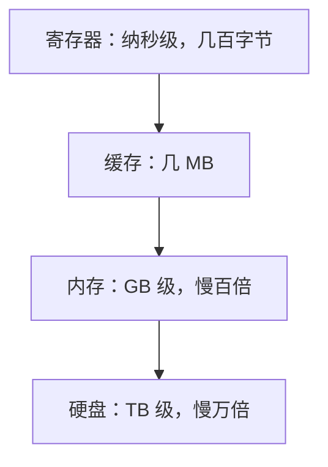

## CPU 是干什么的

CPU（中央处理器）就是上一篇厨房里的**主厨**：从存储器里取出指令，逐一执行，永不停止地循环。它不聪明——不会思考，只会执行极其简单的指令；它恐怖的地方在于**快**：现代 CPU 每秒执行几十亿条这样的简单指令。

简单 × 极快 = 你眼前流畅的一切。

## 指令：主厨的菜谱步骤

CPU 能听懂的指令屈指可数，每条都简单到无聊：

- 从内存某处取一个数，放进寄存器（CPU 手边的小格子）
- 把两个数相加
- 把结果写回内存
- 跳转到另一条指令

把几十亿条这样的"笨指令"按正确顺序排好，就是程序。**再炫酷的软件，拆到底都是这些微不足道的小步骤**。

用 Stepper 走一遍 CPU 的基本工作循环（指令周期）：

<Stepper title="一条指令的一生" steps={[
  { title: "取指（Fetch）", description: "控制器按程序计数器的地址，从内存取出下一条指令。", states: [{ label: "程序计数器", value: "指向下一条" }, { label: "内存", value: "交出指令" }] },
  { title: "译码（Decode）", description: "控制器分析这条指令要干什么：是加法？取数？还是跳转？", states: [{ label: "控制器", value: "翻译指令" }] },
  { title: "执行（Execute）", description: "运算器执行具体操作，例如把两个数相加。", states: [{ label: "运算器", value: "计算中" }] },
  { title: "写回（Write Back）", description: "结果写回寄存器或内存，程序计数器指向下一条指令，循环重新开始。", states: [{ label: "结果", value: "已保存" }, { label: "程序计数器", value: "下一条指令" }] }
]} />

取指 → 译码 → 执行 → 写回，每秒重复几十亿次。这个循环有个名字：**指令周期**。

<Callout type="tip" title="3 GHz 是什么意思？">

频率 3 GHz ≈ 每秒 30 亿个时钟节拍，每个节拍推进指令周期的一步。可以粗略理解为"主厨每秒挥刀 30 亿次"。频率越高节奏越快，但散热和物理极限让它不能无限提——所以有了下面的"多核"。

</Callout>

## 核：多请几个主厨

一个核就是一套独立的执行单元。4 核、8 核等于厨房里同时有 4 个、8 个主厨，各做各的菜（不同程序），或合力做大菜（一个程序拆成多份）。

| 配置 | 形象理解 |
|------|----------|
| 单核 3 GHz | 一个快手主厨 |
| 8 核 3 GHz | 八个快手主厨分工协作 |

多核不是简单叠加：饭菜能不能同时做多道，取决于"菜谱"（软件）会不会拆分任务。这就是为什么有些软件用了多核速度暴增，有些毫无变化。

## 寄存器与缓存：手边的台面

主厨不会每切一片肉都跑仓库取——手边得有个台面。CPU 的存储分层：

- **寄存器**：CPU 内部的超小格子（几十个），速度最快，存放正在处理的数
- **缓存（Cache）**：CPU 旁边的小仓库（几 MB），存放"马上可能用到"的数据

为什么缓存有效？因为程序有个规律：**刚用过的数据，马上大概率还要用**（局部性原理）。把数据提前搬到缓存，CPU 就不用每次都跑慢吞吞的内存。

<Accordion title="延伸一步：流水线是什么？">

聪明的 CPU 不会等一条指令做完四步才取下一条——像洗衣店一样，第一台洗衣机还在转，第二台已经塞进烘干机。四步流水线让 4 条指令重叠执行，效率接近翻倍。现代 CPU 更是把流水线做到十几级，还支持乱序执行——不过对初学者，记住"重叠提高吞吐"这个直觉就够了。

</Accordion>

<FlashCard front="指令周期的四步是什么？" back="取指（从内存取指令）→ 译码（分析要干什么）→ 执行（运算器干活）→ 写回（保存结果）。CPU 每秒把这个循环跑几十亿次。" />

## 动手试一试

1. 打开任务管理器（Ctrl+Shift+Esc），看看你的 CPU 有几个核、频率多少、当前占用率。
2. 思考：为什么同时开 20 个网页通常不卡，但渲染一个大视频却要把 CPU 吃满？（提示：任务的"可拆分程度"不同）
3. 用厨房类比给别人讲一遍"为什么 CPU 需要缓存"。

<Quiz
  question="8 核 CPU 一定比 4 核快一倍吗？"
  options={["一定，核越多越快", "不一定，取决于程序能不能有效拆分到多个核", "只在玩游戏时成立", "取决于内存大小"]}
  answer={1}
  explanation="能拆分的任务（渲染、压缩）确实受益明显；串行依赖强的任务（某些单线程程序）一个核干活其他核围观。核数是上限，软件能不能用上才是关键。"
/>
