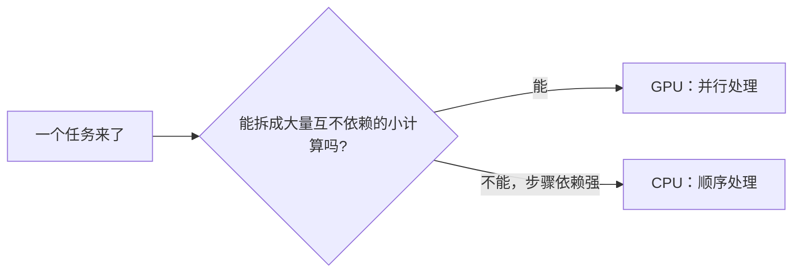

## 两种天才

CPU 和 GPU 都是芯片，都在算数，但性格完全相反：

| | CPU | GPU |
|---|-----|-----|
| 结构 | 少数几个极强核心 | 数千个极简核心 |
| 类比 | 几位博士 | 一千个小学生 |
| 擅长 | 复杂的、前后依赖的任务 | 大量简单、彼此相同的任务 |
| 不擅长 | 同时干一万件杂事 | 逻辑复杂的决策 |

博士能一个人解微积分、写论文、处理突发状况——**单兵作战能力强**。一千个小学生解不动微积分，但让他们**每人算一道乘法题**，一瞬间全部算完——**人多力量大**。

## GPU 为什么而生

GPU（显卡上的处理器）最初就是为游戏画面而生的。屏幕上百万个像素，每个像素要算颜色——这些计算的特点：

1. **数量巨大**：一帧画面两百万像素
2. **彼此相同**：每个像素算的都是同一套公式
3. **互不依赖**：左上角像素的颜色不影响右下角

这正是"一千个小学生"的完美舞台：同一个程序，复制给数千个核心，每个核心处理一个像素。游戏画面因此从卡顿走向丝滑。

## AI 时代：GPU 的第二春

2010 年代研究者发现，AI 神经网络的训练本质上是**海量的矩阵乘法**——同样满足上面的三个特点：数量巨大、计算相同、相互独立。

于是 GPU 从游戏显卡变成了 AI 基础设施：

```text
训练一个大模型 = 万亿次矩阵乘法
CPU 做：按天计
GPU 做：按小时计（上千核心同时开算）
```

今天训练大模型用的动辄上万张 GPU 组成集群，"算力"这个词大部分时候指的就是 GPU 的处理能力。你手机里拍照的智能优化、语音助手，背后也都有专门的处理单元在跑同类的计算。

<Callout type="info" title="现代芯片已经互相渗透">

CPU 里有小的图形单元（核显），GPU 里也加入了调度复杂任务的专用电路；AI 芯片（NPU/TPU）则按神经网络的特点进一步定制。分工在融合，但"通用强 vs 并行强"的基本格局没变。

</Callout>

## 怎么判断任务该给谁

一句话判断法：

- **任务能拆成一堆互不依赖的小计算？** → GPU（渲染、矩阵运算、批量图片处理）
- **任务步骤环环相扣、需要灵活判断？** → CPU（跑程序、操作系统、数据库）

现实软件常常两者协作：游戏里 CPU 负责游戏逻辑（你在哪、怪物 AI），GPU 负责画面渲染；剪辑导出视频时 CPU 调度、GPU 编码。**好搭档，不是替代关系**。



<FlashCard front="CPU 和 GPU 的根本区别是什么？" back="CPU 是少数极强核心，擅长复杂且前后依赖的任务；GPU 是数千个简单核心，擅长海量、相同、互不依赖的并行计算。一个像博士，一个像一千个小学生。" />

## 动手试一试

1. 任务管理器 → 性能标签，分别看 CPU 和 GPU 的核心数量与占用率；播放一个视频或打开一个游戏，观察 GPU 占用上升。
2. 想一想：处理"全班成绩表求平均"（一个总数）和"给 100 万张图片统一调亮"（各自独立），分别该给谁做？
3. 为什么"煎 100 个蛋"GPU 快，而"按菜谱一步步做一道佛跳墙"CPU 快？用自己的话讲一遍。

<Quiz
  question="下面哪个任务最适合交给 GPU？"
  options={["运行数据库响应复杂查询", "给一百万张图片各自应用同一个滤镜", "解析用户输入的命令并逐步执行", "协调多个程序的运行顺序"]}
  answer={1}
  explanation="百万张图片各自独立、计算相同、互不依赖——标准的并行场景。其余三项步骤依赖强、需要灵活判断，是 CPU 的主场。"
/>
