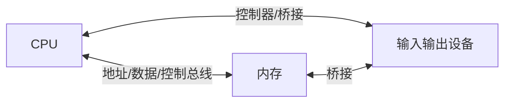
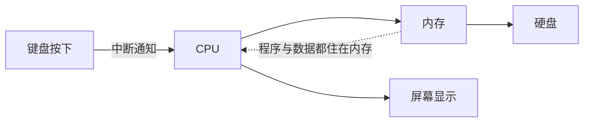

## 部件之间怎么"对话"

CPU、内存、硬盘、键盘、屏幕都有了，但它们各在各的位置，数据和指令靠什么流动？靠**总线**（bus）——贯穿整个主板的一组公共线路。

用快递系统理解最贴切：

- **地址总线**：快递单上的"收件地址"——CPU 想读写内存哪个位置
- **数据总线**：货车车厢——真正搬运的数据，一次能运多少位（32 位/64 位之说就来自这里）
- **控制总线**：交通信号灯——这趟是读还是写、什么时候发车

<Callout type="info" title="64 位系统指什么？">

数据总线和 CPU 寄存器一次能处理 64 个二进制位，就是 64 位系统。它意味着 CPU 一次搬的数据更宽、能直接访问的内存地址空间也大得多（32 位系统最多认 4 GB 内存——这就是老电脑装 8 GB 内存只能用到 4 GB 的原因）。

</Callout>

## 外设五花八门，怎么统一接入

键盘、鼠标、摄像头、打印机、U 盘——接口、速度、协议天差地别。如果每个设备都要 CPU 亲自适配，主厨就别做菜了。解法和软件世界一样：**定标准 + 加中间层**。

- **统一接口标准**：USB、HDMI、PCIe——不管什么设备，插口和对话规则是同一套
- **设备驱动**：每个设备的"翻译官"，把通用指令翻译成设备听得懂的方言。装驱动 = 给系统配翻译

所以"插上设备就能用"这件事背后：接口标准统一了物理连接，驱动解决了内部差异。

## CPU 怎么知道设备找它

键盘按下了一个键，CPU 正忙着算别的——谁来通知它？两种方式：

1. **轮询**：CPU 每隔一会儿问一遍"键盘有动静吗？鼠标呢？摄像头呢？"——简单，但把时间浪费在反复询问上
2. **中断**：设备有情况时**主动举手**，CPU 暂停手头工作处理一下，处理完继续——现代计算机的选择

<Callout type="tip" title="中断无处不在">

你在文档里打字、后台同时下载文件、音乐不停播——正是中断机制让 CPU 能"一心多用"：每个设备举手时快速响应一下，没人举手时全力干活。中断是现代操作系统调度一切的基础，后面学操作系统和计网时会不断遇到它。

</Callout>

## 全景图合上了

五篇连起来，一台计算机的骨架你已经完整掌握：

- 键盘按下 → **中断**通知 CPU（本篇）
- CPU 从内存取指令执行（CPU 篇），指令和数据都是二进制（二进制篇）
- 正在处理的文档在内存，保存后进硬盘（存储篇）
- 最终画面由显示器呈现（总览篇的输出设备）

这就是"计算机组成"的全部主干。接下来无论是计算机网络（计算机怎么和别的计算机说话）还是数据结构（数据在内存里怎么组织），都建立在这张全景图上。

<FlashCard front="中断比轮询好在哪？" back="轮询是 CPU 反复主动询问，大量时间浪费在空检查上；中断让设备有需要时主动举手，CPU 平时可以全力干活，响应还更及时。" />

## 动手试一试

1. 查一下你的电脑是 32 位还是 64 位系统（设置 → 关于），回想为什么 32 位最多认 4 GB 内存。
2. 打开设备管理器，随便点开一个设备的"驱动程序"标签——你看到的正是"翻译官"的名片。
3. 用快递类比，给别人完整讲一遍"地址总线、数据总线、控制总线"。

<Quiz
  question="为什么插上新鼠标通常不用手动装驱动也能用？"
  options={["鼠标不需要驱动", "系统内置了 USB 标准设备的通用驱动", "鼠标自带屏幕", "总线自动翻译所有协议"]}
  answer={1}
  explanation="USB 等标准接口的通用设备，操作系统自带标准驱动，即插即用。小众或专业设备仍需厂商驱动提供完整功能（如可编程按键）。"
/>
