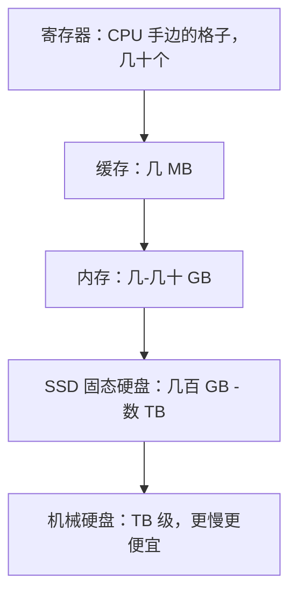

## 两种"记忆"

你一定经历过：文档写着写着突然断电，没保存的内容全没了——但硬盘里的老文件安然无恙。因为计算机有两种脾气完全不同的"记忆"：

| | 内存（RAM） | 硬盘（磁盘 / SSD） |
|---|---|---|
| 速度 | 极快（纳秒级） | 慢（万倍以上差距） |
| 断电后 | **全部丢失** | 完好保存 |
| 容量 | 小（8-32 GB） | 大（512 GB - 数 TB） |
| 角色 | 工作台 | 仓库 |

**内存是工作台**：桌面宽敞、伸手就到，但下班（断电）就清空。你打开的程序、正在编辑的文档，全摊在工作台上。

**硬盘是仓库**：架子高、翻找慢，但锁门后东西一件不少。照片、软件、系统本身，都长期住在仓库里。

<Callout type="info" title="「保存」到底发生了什么？">

保存 = 把工作台（内存）上的内容抄一份送进仓库（硬盘）。所以编辑软件都有自动保存：抄得越勤，断电时损失越少。那个"未保存"的文档，只是还躺在一张会消失的桌子上。

</Callout>

## 为什么不干脆全用快的？

因为快和大是一对矛盾，且快得越多越贵。同样的钱，能买一大块慢存储，只能买一小块快存储。计算机的解法不是二选一，而是**全都要**——按速度排成一座金字塔：

规律：**越往上，越快、越小、越贵；越往下，越慢、越大、越便宜**。CPU 顺着金字塔逐层往下找数据。

## 金字塔为什么有效

靠的是程序的**局部性**：

1. **时间局部性**：刚用过的数据，马上大概率还要用（你正在打的这份文档）
2. **空间局部性**：用了第 100 号数据，接下来大概率用 101、102 号（连续读文件）

所以系统提前把"热门数据"搬到塔的上层。大部分请求都能在快层命中，慢层只在开场跑一趟——**用一小块贵的快存储，撬动一大块便宜的慢存储**，整体速度逼近快层，整体容量却等于慢层。

<Tabs label="对比两种硬盘" defaultValue="ssd">
<Tab value="ssd" label="SSD 固态硬盘">

- 没有机械部件，纯电子存取
- 快：开机几秒、软件秒开
- 贵：同样价格容量较小
- 现在电脑的主流配置

</Tab>
<Tab value="hdd" label="机械硬盘 HDD">

- 里面有真的转盘和磁针，物理寻道
- 慢：慢 SSD 几十到上百倍
- 便宜：适合当大容量仓库
- 监控录像、备份盘的常客

</Tab>
</Tabs>

## 内存多大才够

内存 = 同时摊在工作台上的东西总量。开太多程序、浏览器开几十个标签，工作台塞满了怎么办？系统会把不常用的数据临时挪回硬盘（虚拟内存），速度暴跌——这就是"电脑越用越卡"的常见原因之一。

内存够用的标志：日常使用时任务管理器里内存占用低于八成。不够就加——内存是性价比最高的升级之一。

<FlashCard front="内存和硬盘最核心的两条区别？" back="内存快但断电丢失、容量小；硬盘慢但断电不丢、容量大。程序运行时必须先从硬盘加载进内存，CPU 只和内存打交道。" />

## 动手试一试

1. 打开任务管理器，看看内存总容量和当前占用，数数你同时开着多少程序。
2. 体会一下层次差：从硬盘打开一个文件夹要零点几秒，而正在编辑的文档打字零延迟——这就是金字塔各层的速度差。
3. 思考：为什么"16 GB 内存 + SSD"的电脑比"8 GB 内存 + 机械硬盘"体验好得多？

<Quiz
  question="正在编辑但还没保存的文档存在哪里？"
  options={["硬盘里", "内存里", "CPU 寄存器里", "缓存里"]}
  answer={1}
  explanation="编辑中的内容在内存（工作台）上，断电即失。点保存才复制进硬盘（仓库）。CPU 和缓存只临时经手正在计算的片段，不可能容纳整个文档。"
/>
