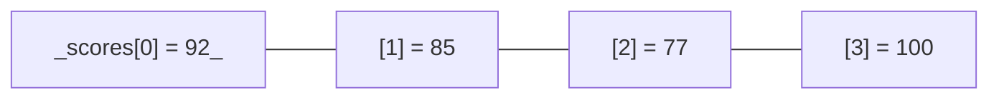

## 连续的房间

数组是所有结构里最朴素的一种：**数据在内存里一个紧挨一个地排成一排**。计组篇说过，内存本来就是一排编号的格子——数组就是从中划出连续的一段。



连续存放带来一个惊人的能力：**只要知道下标，取值一步到位**。

## 为什么按下标取值是 O(1)

计算机算术就是快在这一点上。内存每个格子都有地址，数组起始地址记为 `start`，每个元素占 8 字节，那么：

```text
scores[3] 的地址 = start + 3 × 8
```

一次乘法一次加法，直接跳到目标格子——**不管数组有 10 个还是 1000 万个元素，取 `scores[i]` 都是一步**。这就是 O(1)，也是数组成为一切基石的原因。

Python 里 `scores[3]` 背后干的就是这道算术题。

## 插入与删除：要命的搬家

连续存放是取值的福利，却是插入的噩梦。想在开头插一个新数：

```text
原来：[92, 85, 77, 100]
插入 50 到最前：[50, 92, 85, 77, 100]
                      ↑ 全员向后挪一格
```

后面所有元素都得搬家，n 个元素就是 O(n) 步。删第一个同理，全员向前挪。只有**在末尾追加**是 O(1)——不用惊动任何人。

| 操作 | 步数 | 原因 |
|------|------|------|
| 按下标取 `a[i]` | O(1) | 地址算术直达 |
| 末尾追加 | O(1) | 直接站队尾 |
| 头部/中间插入删除 | O(n) | 后面全员搬家 |
| 按值查找 | O(n) | 只能挨个比对（无序时） |

<Callout type="tip" title="写代码时的直接指导">

Python 里 `list.insert(0, x)`（往头上插）是 O(n) 操作，循环里反复往头上插，总步数就是 O(n²)——程序突然变慢多半是这种地方。要频繁往头上加，考虑换 `collections.deque`（下一篇队列的主角）或换个存法。

</Callout>

## Python list 的真实身份

Python 的 `list` 就是**动态数组**：底层还是连续存放，但会"多租几个房间"留余地。元素满了就整体搬去更大的连续空间（扩容），平时追加依然够快。

```python filename="list-nature.py"
scores = [92, 85, 77]
scores.append(100)      # O(1) 均摊：站在队尾
print(scores[2])        # O(1)：地址直达
scores.insert(0, 50)    # O(n)：全员搬家
scores.pop()            # O(1)：队尾离开
print(scores)           # [50, 92, 85, 77]
```

`append`、下标取值随便用；`insert(0, ...)`、`pop(0)` 想想再写。

## 什么时候选数组

- ✔ 知道下标、按位置读写是主旋律
- ✔ 主要在尾部增删
- ✘ 头部中间频繁插删（考虑链表或 deque）
- ✘ 按值快速查找（考虑哈希表，第四篇）

<FlashCard front="数组取值 O(1) 的秘密是什么？" back="内存地址是连续且等距的，起始地址 + 下标 × 元素大小直接算出目标地址，一步直达。代价是插入删除会牵连后面的元素集体搬家。" />

## 动手试一试

1. 生成 10 万个元素的列表，分别测量 `append` 和 `insert(0, x)` 十万次的总耗时，感受数量级差距。
2. 想想超市收银台排队：新来的人插到最前面，后面的人有什么感觉？这就是 `insert(0, x)`。
3. 用 Python 列表实现"记录最近 3 条消息"：新消息来了 append，超过 3 条就 `pop(0)`——分析每步的复杂度。

<Quiz
  question="scores = [1, 2, 3] 后执行 scores.insert(0, 0)，底层大致发生了什么？"
  options={["直接把 0 放进第一个空位", "3 个原有元素全部向后挪一格，再放 0", "新建一个数组，旧的丢弃", "报错，头部已满"]}
  answer={1}
  explanation="连续存放决定了头部插入必须把后面所有元素整体后移，O(n)。这也是为什么批量往头部插数据应该换 deque 或先收集再反转。"
/>
