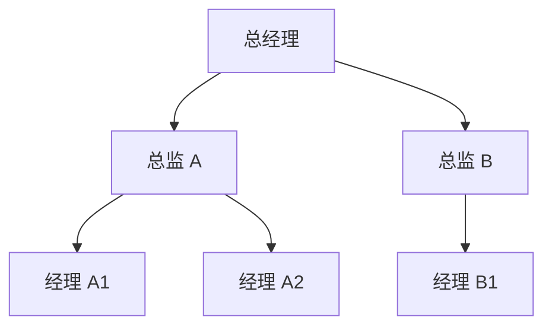
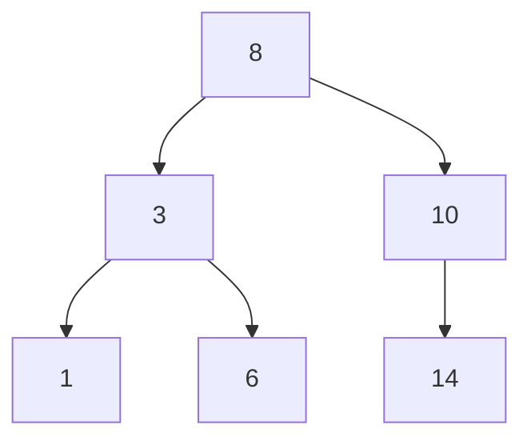

## 数据也有"上下级"

数组、栈、队列、哈希表都是"平铺"的——数据一个挨一个。但很多数据天生有层级：

- 文件夹里有子文件夹和文件
- 公司里总经理管总监，总监管经理，经理管员工
- 家谱：你、父母、祖父母……

这类"一对多"的关系，平铺的结构装不下，需要**树**（tree）。

## 树的部件

把层级画出来，形状像一棵倒着长的树：



几个术语对着图看一遍就懂：

| 术语 | 含义 | 图中例子 |
|------|------|----------|
| 根（root） | 最顶层的节点 | 总经理 |
| 节点（node） | 每个圆圈 | 每个职位 |
| 叶子（leaf） | 没有下级的节点 | 经理们 |
| 父 / 子 | 直接连线的上下级 | 总经理是总监 A 的父 |

每层都是"父管子"，且**每个节点只有一个父**（根除外）——有环、有多父就不是树了（那是下一篇的图）。

## 树怎么遍历：文件夹哲学

浏览文件夹的方式就是树的遍历：

- **深度优先**：点进一个文件夹，一直钻到最深处，退出来再钻下一个——一条道走到黑
- **广度优先**：先看完本层所有文件夹，再进下一层——一层层铺开

两种遍历访问到的内容一样，顺序不同，适用的任务不同（找"最深的东西"用深度，找"离根最近的"用广度）。

## 明星选手：二叉搜索树

每个节点**最多两个子节点**（二叉），且整棵树守一条规矩：

> **左边的所有子孙 < 我 < 右边的所有子孙**



规矩一立，查找就变成**折半**：找 6，从根 8 出发，6 < 8 往左；到 3，6 > 3 往右；到 6，命中。没走过的半边直接不看。

```python filename="bst-idea.py"
def search(node, target):
    while node is not None:
        if target == node.value:
            return node           # 命中
        node = node.left if target < node.value else node.right
    return None                   # 走到头，不存在
```

还记得第一篇"数步数"里的折半查找吗？**二叉搜索树就是能动态增删的折半**。数组折半查找快，但插入要搬家；链表插入快，但没法折半。二叉搜索树把两头的好处都拿了：

| 结构 | 查找 | 插入 |
|------|------|------|
| 有序数组 | O(log n) | O(n) 搬家 |
| 有序链表 | O(n) | O(1) |
| 二叉搜索树（平衡时） | **O(log n)** | **O(log n)** |

<Callout type="warning" title="平衡是前提">

如果插入顺序恰好是有序的（1, 2, 3, 4, 5……），二叉搜索树会长成一根"歪脖子树"（全是右儿子），折半退化成逐个找。解决方案是把树**自动旋转保持平衡**（AVL 树、红黑树）——语言内置的有序集合用的都是它们。初学记住结论即可：**成熟的树结构自带平衡，O(log n) 是有保障的**。

</Callout>

## 树无处不在

- 文件系统、网页的 DOM 结构——树
- 数据库索引——B 树 / B+ 树（多叉版二叉搜索树）
- 编程语言里你的代码本身——语法树
- 自动补全、拼写检查——前缀树

学会认树，软件世界一半的"结构感"就到位了。

<FlashCard front="二叉搜索树为什么查找是 O(log n)？" back="左小右大的规矩让每次比较都能排除一半节点，路径长度最多等于树高。平衡时树高约是 log n——折半查找的思想换了一种可以动态增删的载体。" />

## 动手试一试

1. 把 [8, 3, 10, 1, 6, 14, 4] 依次插入二叉搜索树，画出手画版的树，再按"左根右"顺序读一遍，观察输出是不是有序的。
2. 把 [1, 2, 3, 4, 5] 依次插入，画出退化形态，理解"平衡"为什么重要。
3. 用文件夹树举例，说清深度优先和广度优先各自的应用场景。

<Quiz
  question="在二叉搜索树里查找一个不存在的值，路径长度最坏等于什么？"
  options={["永远一步", "树的层数（树高）", "节点总数", "无限长"]}
  answer={1}
  explanation="每次比较下沉一层，走到底（叶子）还没命中就确认不存在。平衡时树高是 O(log n)，歪脖子树退化到 O(n)——所以平衡是性能承诺的前提。"
/>
