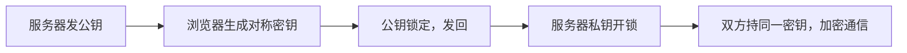

## HTTP 的致命弱点

上一篇的 HTTP 对话是**明信片**：途经的每一个路由器、每一次 Wi-Fi 中转，都能读到你发的一切——密码、短信验证码、聊天记录。在咖啡馆连公共 Wi-Fi 时尤其危险：同网络的人可以轻松旁观。

更糟的还有两件事：**偷看**（看内容）、**篡改**（运营商往网页里插广告）、**冒充**（假网站骗你输入密码）。HTTPS 要一次解决三件事。

## 密封信件：对称加密

HTTPS 的基础思路是**加密**：把内容用"密钥"搅乱，只有持同款密钥的人能还原。

- 密钥相同、加密解密对称 → **对称加密**（如同锁和钥匙同一把）
- 速度极快，适合加密大流量数据

但有个死结：**密钥怎么安全地给对方？** 网络本身不安全，直接寄钥匙等于把密码贴在明信片上寄出去。这叫密钥分发难题。

## 两把钥匙的魔术：非对称加密

1970 年代的数学突破解决了它——**非对称加密**：一对钥匙，公钥加密的内容**只有私钥能解开**，反之亦然。

- **公钥**：随便发，谁都能拿（像挂在门口的开放锁箱）
- **私钥**：只留自己（锁箱的钥匙）

于是有了巧妙流程：

1. 服务器把**公钥**大方地发给浏览器
2. 浏览器生成一把随机的**对称密钥**（真正干活的数据钥匙）
3. 用服务器公钥把这把对称密钥**锁起来**发回去
4. 途中谁都能看到这把"锁着的箱子"，但没有私钥打不开
5. 服务器用**私钥**开箱，拿到对称密钥——此后双方用这把对称密钥高速加密通信

**用非对称加密传递钥匙，用对称加密传递数据**——各取所长：前者安全分发，后者速度飞快。

## 证书：防止冒充

还剩最后一个漏洞：中间人可以**掉包公钥**——你以为是和真服务器交换密钥，实际在和骗子交换。解法是请"公证处"背书：**证书**（certificate）。

服务器把公钥和自己的身份信息打包，交给权威机构（CA，如 DigiCert、Let's Encrypt）**签名**。浏览器内置了这些权威机构的公钥，收到证书时验签：是官方认证的这家网站，公钥才可信。

浏览器地址栏的小锁🔒，含义就是"这家的身份已由公证处核实"。

| 三大威胁 | HTTPS 的对策 |
|----------|--------------|
| 偷看（窃听） | 加密：抓包只见乱码 |
| 篡改（插广告） | 完整性校验：内容被动过即刻报警断开 |
| 冒充（假网站） | 证书：CA 背书验证身份 |

<Callout type="warning" title="HTTPS 的边界">

HTTPS 保证的是"你和目标网站之间的通道安全"。它**不能**保证：网站本身不作恶（钓鱼网站也可以有自己的证书）、你的电脑没中毒、密码不被网站泄露。看到小锁只代表"传输加密了"，不代表"网站可信"——判断网站可信还要看域名对不对。

</Callout>

## 全网 HTTPS 时代

2015 年之前 HTTPS 还只用于登录和支付页，如今整个 Web 都在它之上：免费证书（Let's Encrypt）消除了成本门槛，浏览器把 HTTP 网站标记为"不安全"，搜索引擎给 HTTPS 网站加分。你现在阅读的本站就是 HTTPS 的。

<FlashCard front="HTTPS 如何同时做到防偷看、防篡改、防冒充？" back="防偷看：对称加密通信内容；防篡改：完整性校验，改动即被发现；防冒充：CA 签发的证书验证服务器身份。钥匙分发用非对称加密解决。" />

## 动手试一试

1. 浏览器点开任意网站的地址栏小锁，查看"证书"：颁发机构是谁？有效期到哪天？
2. 开发者工具 Network 面板勾选任意请求，看协议列——现代网站几乎都是 `h2` 或 `h3`（HTTP/2、HTTP/3，跑在 HTTPS 上的升级版）。
3. 故意访问一个 `http://` 开头的网站（老站点或本地测试），观察浏览器地址栏的"不安全"标记。

<Quiz
  question="HTTPS 为什么不全程使用非对称加密，而是先用它交换对称密钥？"
  options={["非对称加密不安全", "对称加密快得多，非对称只用于安全传递密钥", "非对称加密不支持长文本", "纯粹的历史习惯"]}
  answer={1}
  explanation="非对称加密的数学运算比对称加密慢成百上千倍，网页每秒传输的海量数据扛不住。取长补短：安全分发用非对称，高速传输用对称。"
/>
