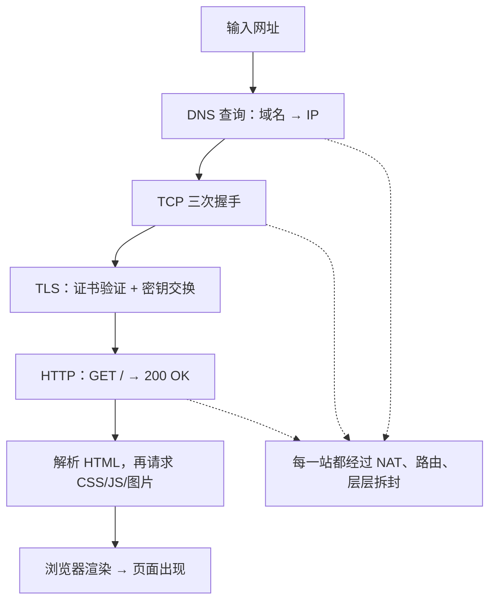

## 终极复习题

你在浏览器地址栏输入 `example.com` 回车，到页面完整出现，大约过了半秒。这半秒里，本系列讲过的每个角色都登场了。这篇是**总复习**：按时间顺序把全系列串一遍。

## 第一幕：问路（DNS）

1. 浏览器查本地缓存：`example.com` 的 IP 最近查过吗？没有
2. 问运营商 DNS 服务器（**电话簿**），层层接力后得到答案：`93.184.216.34`

> 对应篇目：IP 地址与 DNS——门牌号与电话簿

## 第二幕：敲门（TCP 握手）

3. 浏览器向 `93.184.216.34:443` 发起 TCP 连接——**三次握手**：SYN → SYN+ACK → ACK，双方对好暗号、同步编号

> 对应篇目：TCP 与 UDP——可靠性的笨功夫；TCP 三次握手——逐步核对状态

## 第三幕：对暗号（TLS）

4. HTTPS 站点先"验明正身"：服务器出示**证书**，浏览器核对公证处签名
5. 双方用非对称加密交换密钥，之后改用对称密钥加密通信——**明信片升级成密封信件**

> 对应篇目：HTTPS 与加密——防偷看、防篡改、防冒充

## 第四幕：对话（HTTP）

6. 浏览器发出 `GET /` 请求（应用层的"普通话"）
7. 服务器回 `200 OK` 和 HTML；浏览器解析 HTML，发现还要 CSS、JS、图片……于是**重复第一到四幕**把资源取回
8. 每个请求都带着 **Cookie**（会员卡），服务器得以认出你是谁

> 对应篇目：HTTP——方法、状态码、无状态与 Cookie

## 第五幕：拆包裹（层层解封）

9. 每个数据包到达你家：路由器按 **NAT 映射表**改写地址投给你的电脑（家庭上网篇）
10. 你的电脑逐层拆封：**链路层**收帧 → **网络层**核对 IP → **传输层**按序号重排、发确认 → **应用层**收到完整数据（分层模型篇）

## 全景图

<Callout type="tip" title="为什么有时快有时慢？现在你能精确诊断了">

- 打不开，但 ping 得通 → 传输层之后的问题（服务器或防火墙）
- "正在解析主机"卡住 → DNS 慢（电话簿阶段堵了）
- 转圈很久最后超时 → 服务器没响应（HTTP 阶段堵了）
- 内容出来了但图片慢慢加载 → 静态资源请求慢（应用层资源多）

**按层排查**——学完系列后，"网页打不开"不再是一团迷雾，而是一张有先后顺序的检查清单。

</Callout>

## 系列毕业

到这里，"从网线到浏览器"的完整故事讲完了：

| 篇目 | 你学到的 |
|------|----------|
| 什么是计算机网络 | 分组交换、逐跳路由 |
| IP 与 DNS | 门牌号、电话簿、端口 |
| TCP 与 UDP | 两种传输性格 |
| 三次握手 | 连接如何建立 |
| HTTP | Web 世界的普通话 |
| HTTPS | 密封信件与公证处 |
| 分层模型 | 全部知识的框架 |
| 家庭上网 | 你家门口这一段 |
| 本篇 | 串起来的能力 |

下一步建议：用数据结构篇学的知识写一个小爬虫（Python 方向篇有入门），或抓包工具（如浏览器开发者工具）观察真实流量——**自己动手发一次请求，胜过再读十遍**。

<FlashCard front="按顺序说出打开网页的五个阶段" back="①DNS 解析（域名变 IP）；②TCP 三次握手；③TLS 证书验证与密钥交换（HTTPS）；④HTTP 请求与响应（可能循环多次取资源）；⑤浏览器渲染。每一步都可能失败，对应不同的故障现象。" />

## 动手试一试

1. 打开开发者工具 Network 面板，刷新本站首页：数一数请求数量，点开第一个请求看它的 DNS、TCP、TLS 各耗时多少——真实世界的五幕就在眼前。
2. 用 `nslookup` + `ping` + `curl -i` 三件套手动复现第一、二、四幕。
3. 给完全没学过网络的朋友，用五幕故事讲完"打开一个网页"，检验自己的掌握程度。

<Quiz
  question="页面所有请求都超时，但 DNS 查询秒回、ping 也通。问题最可能出在哪一幕？"
  options={["DNS 解析", "TCP 握手之后的对话阶段（服务器或中间网络故障）", "本地没网", "浏览器坏了"]}
  answer={1}
  explanation="DNS 和 ping（ICMP）都正常说明地址解析与基础连通没问题；TCP/HTTP 阶段全部超时，指向服务器没响应或中间链路对该端口不通。分层排查的价值就在于此。"
/>
