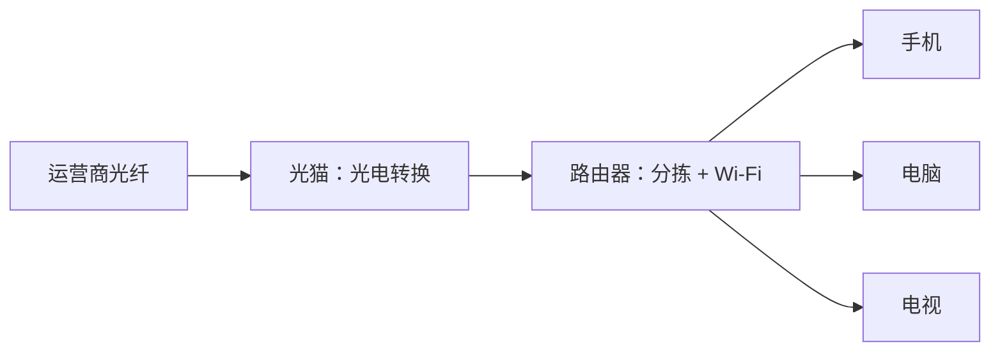

## 家里网络的真身

你家上网的设备链其实很短：



- **光猫**：把光纤里的光信号转成电信号（"猫"是调制解调器 modem 的音译）
- **路由器**：家里网络的**总管**——对内分配地址、转发数据，对外代表全家说话
- 很多家庭是"光猫路由器二合一"的一个盒子

## NAT：全家共用一个门牌

IP 篇说过：家里设备用的是内网 IP（`192.168.x.x`），对外只有一个**公网 IP**。那外界的回信怎么知道送给家里哪台设备？靠路由器的**NAT**（网络地址转换）：

```text
手机请求网页：
  手机(192.168.1.100) → 路由器：我要访问 93.184.216.34:443
路由器改造后发出去：
  路由器(公网IP) → 服务器，并记住："端口 51022 这单是 192.168.1.100 的"
服务器回信给：
  路由器公网 IP:51022
路由器查表改写：
  转发给 192.168.1.100 —— 手机收到
```

路由器维护一张**映射表**：出走的每个请求记一笔"端口号 ↔ 内网设备"，回信按表投递。全家几十台设备共享一个公网 IP，靠的就是这张表。

<Callout type="info" title="这也解释了几件事">

- 为什么 IP 篇说 43 亿个 IPv4 地址"居然够用"——NAT 让一个公网号服务一整个家庭甚至公司
- 为什么外网无法直接访问你家里的设备——路由器的映射表里没有的来信一律拒收，这是天然的第一道防线
- 为什么"远程访问家里的电脑"需要额外设置（端口映射/内网穿透）——要主动在映射表上开一个口子

</Callout>

## Wi-Fi：最后一段无线电

从路由器到你手机这一段，数据是**无线电波**。Wi-Fi 不是什么新协议体系，而是**链路层**的一种实现（分层模型篇的"最后一段邮车"换了车型）：

- 路由器以固定频率广播自己的名字（SSID）
- 设备连接时协商加密方式（现代 Wi-Fi 用 WPA2/WPA3 加密）
- 之后数据就在这段无线电波上加密封送

<Callout type="warning" title="公共 Wi-Fi 为什么危险">

家里的 Wi-Fi：链路已加密，且都是自家设备，安全。咖啡馆的公共 Wi-Fi：同一网络的陌生人可能截获未加密流量、伪造钓鱼热点。HTTP 篇说过明信片问题——**在公共 Wi-Fi 上，只有 HTTPS 网站才是密封信件**，其他流量等于裸奔。好在如今全网 HTTPS 时代，风险已大幅收窄，但连接陌生热点仍需警惕。

</Callout>

## 上网慢？按链路排查

有了全家桶视角，"网慢"有了清晰的排查地图：

| 症状 | 可疑环节 | 试试 |
|------|----------|------|
| 所有设备都慢 | 运营商出口 / 光猫 | 重启光猫、测速对比套餐带宽 |
| 只有 Wi-Fi 慢，网线正常 | 无线信号 | 靠近路由器、换 5G 频段、减少隔墙 |
| 网速正常但网页开不开 | DNS（电话簿） | 换公共 DNS（如 223.5.5.5） |
| 只是某几个网站慢 | 对方服务器或线路 | 换个时段再看 |

<FlashCard front="NAT 解决了什么问题？" back="让全家设备共享一个公网 IP：路由器用'端口号 ↔ 内网设备'映射表改写进出数据包。既缓解了 IPv4 地址枯竭，也让外网无法直接敲门，成为一道天然防线。" />

## 动手试一试

1. 登录家里路由器的管理页面（通常 `192.168.1.1` 或 `192.168.0.1`），看一眼"已连接设备"列表——NAT 表的具象化。
2. 在手机和电脑上分别搜索"我的 IP"，验证它们对外的公网出口是同一个。
3. 把手机从 Wi-Fi 切到流量，再访问网页，体会"换了最后一段邮车，上层一切照旧"（分层模型的现实演示）。

<Quiz
  question="朋友想远程访问你家电脑，最需要解决的问题是？"
  options={["家里电脑网速不够", "路由器的 NAT 挡住了外网主动进来的连接，需要做端口映射或内网穿透", "电脑没开 Wi-Fi", "域名太长记不住"]}
  answer={1}
  explanation="NAT 映射表由内向外建立，外网主动敲门时路由器不知道转给谁。端口映射是手动在表上开个固定口子，内网穿透则是借助中转服务建立通道。"
/>
