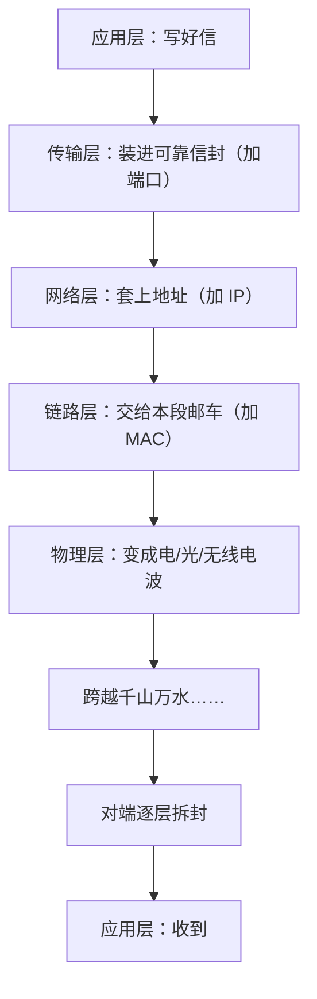

## 一个寄国际快递的例子

你从北京寄一台相机去巴黎。整个过程其实由多个角色接力：

```text
你：把相机装箱、填面单          ← 只关心"寄什么"
快递公司：集散、装飞机、报关    ← 只关心"怎么运"
航空公司：航线调度              ← 只关心"怎么飞"
……巴黎那头反向拆解，最终交付
```

关键洞察：**每个角色只干自己那一段，且只依赖相邻角色的接口**。你不需要懂航空调度，航空公司不需要懂相机——只要大家遵守各自环节的约定（面单格式、托运标准），整个链条就能运转。

**网络分层**就是这个思想：把"从应用发数据到对面应用收到"拆成几层，每层只负责一件事、只和上下层打交道。

## 五层模型：每层管什么

| 层 | 职责 | 本站已有文章 | 数据单位 |
|----|------|--------------|----------|
| 应用层 | 说"什么话"：网页、邮件的对话规则 | HTTP、HTTPS | 消息 |
| 传输层 | 可靠送达对方**程序**：编号、确认、端口 | TCP 与 UDP、三次握手 | 段 |
| 网络层 | 跨网络寻址：IP 地址、逐跳路由 | IP 与 DNS | 包 |
| 链路层 | 同一段线路内的直接传输 | —（家庭上网篇会讲 Wi-Fi/网线） | 帧 |
| 物理层 | 真正的信号：电、光、无线电波 | — | 比特 |

读法：**上层把活交给下层，层层加封套；接收方反向拆封套**。



## 分层的回报

1. **换零件不动全局**：从网线换成 Wi-Fi（物理层、链路层变了），网页代码一个字不用改——就像快递从空运换海运，你填的面单不变
2. **各层独立演进**：HTTP/3 换了传输层协议，IP 从 v4 升 v6，应用层照样活得好好的
3. **问题定位有套路**：网页打不开？自底向上查——网线通吗（物理）→ 有 IP 吗（网络）→ 连得上吗（传输）→ 服务器答话吗（应用）

<Callout type="tip" title="面试常问的 OSI 七层 vs 这里五层">

教科书有 OSI 七层模型（多出"表示层""会话层"），实际工程与教学常用简化的五层（或 TCP/IP 四层）。层怎么切是视角问题——**分层思想和每层职责**才是重点，数目只是记法。

</Callout>

## 用分层重读本系列

前几篇的文章，正好各占一层：

- DNS、HTTP、HTTPS → **应用层**
- 三次握手、TCP/UDP → **传输层**
- IP 地址、路由器逐跳转发 → **网络层**
- 开机篇里的网卡驱动、Wi-Fi/网线 → **链路层与物理层**

至此"从网线到浏览器"的每一层你都有了对应的一篇——系列的知识地图正式拼完。

<FlashCard front="网络分层的好处是什么？" back="各层职责单一、只依赖相邻层接口：换底层技术不用改上层应用，各层可独立演进，故障可以按层排查。寄国际快递的类比：寄件人不懂航空调度也能寄达全球。" />

## 动手试一试

1. 把"你发一条微信消息"按五层走一遍：说了什么话（应用）、怎么保证对方程序收到（传输）、怎么跨城（网络）、最后一段怎么送（链路/物理）。
2. 排查"网页打不开"：按层的顺序列出你会依次检查什么。
3. 思考：如果让你给"寄国际快递"这个系统画分层图，你会分几层、每层管什么？

<Quiz
  question="从网线换成 Wi-Fi 后，正在用的网页应用完全不需要修改。这体现了分层的什么好处？"
  options={["网络更快了", "各层独立：物理与链路层变了，上层协议接口不变", "Wi-Fi 更便宜", "应用层自动适配一切"]}
  answer={1}
  explanation="分层解耦的核心回报：只要层与层之间的约定不变，某一层内部怎么实现（网线还是无线电波）对上层完全透明。"
/>
