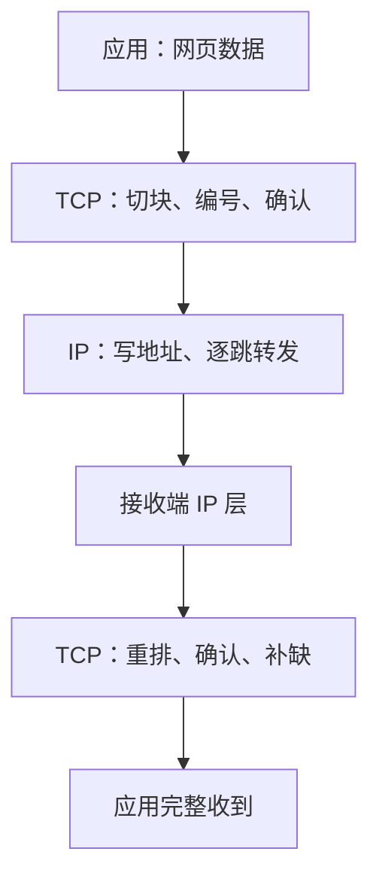

## 包裹寄出去了，然后呢？

上一篇解决了"地址"问题：包裹能从 A 地送到 B 地。但现实问题马上来了：

- 寄了一千个包，**丢了一个**怎么办？
- 包裹**顺序乱了**（走的路线不同），文件拼装错位怎么办？
- 对方**关机了**，我怎么知道？

传输层就是回答这些问题的层。两个方案性格迥异：

| | TCP | UDP |
|---|-----|-----|
| 性格 | 挂号信：签收确认、丢件补寄 | 明信片：寄出去就不管 |
| 可靠性 | 保证送达、保证顺序 | 尽力而为，丢了就丢了 |
| 速度 | 慢一点（要确认） | 快（零负担） |
| 连接 | 先握手建立连接 | 无连接，拿了就发 |
| 代表应用 | 网页、文件传输、邮件 | 视频通话、游戏、直播 |

## TCP：可靠是怎么炼成的

TCP 的可靠不是魔法，是**笨功夫**：

1. **编号**：每个字节都有序号，接收方按号重排、发现缺口
2. **确认**：每收到一段，回一个"收到了"（ACK）；发送方超时没等到，就重发
3. **重传**：没确认的统统再来一遍
4. **流量控制**：接收方处理不过来时告诉发送方"慢点发"

前面已有专篇拆解 TCP 建立连接的三次握手——那正是这套"确认体系"的开场白。连接建立后，编号、确认、重传机制持续运转，直到数据完整送达。

<Callout type="info" title="你每次打开网页都在用它">

浏览器加载页面用的 HTTP 协议跑在 TCP 之上（HTTPS 也是）。所以"网页等一下才出来"的体验里，藏着无数次"确认收到"的往返——可靠性是用时间换来的。

</Callout>

## UDP：快与简单

UDP 几乎不做事：把数据切成包、写上地址、发走。没有握手、没有确认、没有重传。听起来不靠谱？看场景：

- **视频通话**：丢了一帧画面，卡一下就过去了；如果等 TCP 重传再补发，画面早就过时了——**时效比完整更重要**
- **联机游戏**：你的位置信息每秒发几十次，旧的根本没价值，丢了就丢
- **直播**：同样，宁可花屏一瞬，不能延迟十秒

UDP 的哲学：**有些东西，新的比完整的重要**。

## 一个包的旅程：两层协议怎么配合

分工清晰：**IP 负责送到正确的机器，TCP 负责机器上的应用完整无误地收到**。加上端口号（上一篇的"房间号"），数据最终交付给具体的那个程序。

<FlashCard front="TCP 和 UDP 各适合什么场景？为什么？" back="TCP 适合网页、文件等要求完整有序的场景——确认与重传保证不丢；UDP 适合视频通话、游戏等时效敏感场景——丢一包无妨，等待重传反而误事。" />

## 动手试一试

1. 玩一个对照实验：看直播（UDP 典型场景）时故意断网一瞬，观察画面是"花了一下"还是"卡住重放"。
2. 复习本站的 TCP 三次握手篇，想想：如果只有两次握手会出什么问题？（提示：网络里存在延迟很久的旧请求）
3. 思考：在线支付走 TCP 还是 UDP？为什么"钱"必须用 TCP？（答案：一条都不能少）

<Quiz
  question="视频通话公司决定把传输协议从 UDP 换成 TCP，最可能出现什么后果？"
  options={["画面更清晰流畅", "延迟明显变大：丢帧要等待重传，旧画面补发也没意义", "完全没影响", "画质下降但延迟不变"]}
  answer={1}
  explanation="TCP 为可靠性付出的确认与重传代价，在实时音视频里表现为延迟。旧帧到达时早已过时，重传毫无价值——这正是 UDP 存在的理由。"
/>
