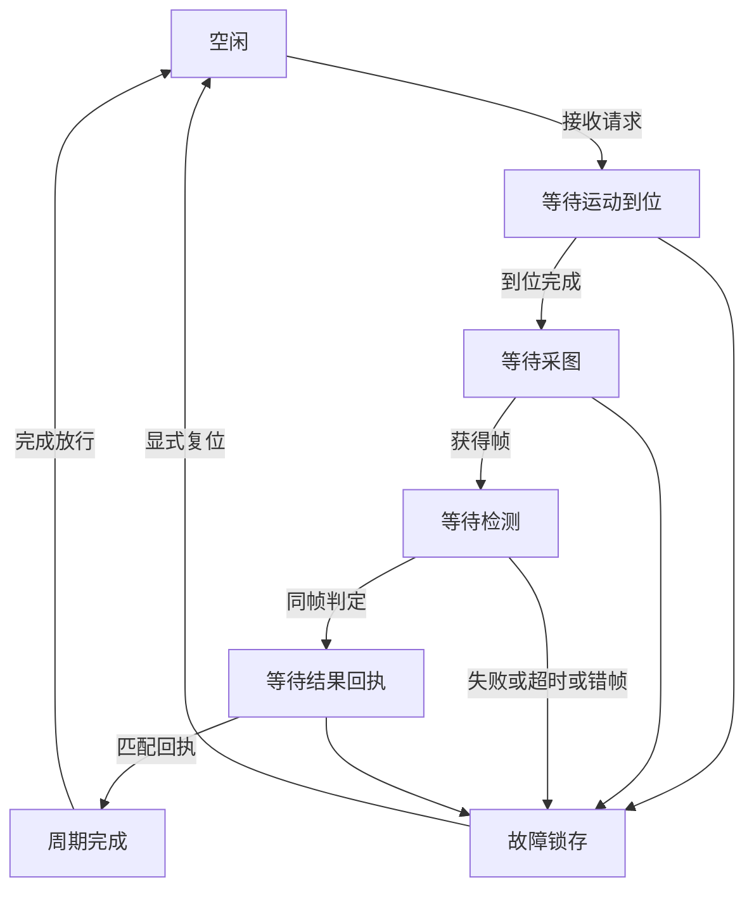

## 1. 综合不是把三个按钮顺序点击

通信能读写、运动能定位、视觉能推理之后，还需要明确它们共同处理的是哪件工件、哪个周期和哪一版配方。单个SDK调用成功，不等于整个工位已经完成。

第12步先建立离线流程模型，再逐批增加异步适配、持久化和界面。第一批不调用PLC、雷赛、机器人、相机或视觉库；它生成模拟命令，接收模拟终态，让流程规则可以被独立检查。

本例的软件Stop只停止后续流程推进，不证明真实设备已停止，也不替代外部设备的安全控制。代码中的就绪、空闲和清料都是测试声明，不能直接当现场观察使用。

## 2. 最小周期及后续分步

第一批采用一个工件、一个周期、最多一个待结命令：到料条件满足 → 请求运动到位 → 请求采图 → 请求检测 → 发布结果 → 等匹配回执 → 保留本地终态。当前没有任务队列、自动重试和多工位并行。

后续按以下顺序扩展，每批保留本轮状态模型：

1. 本批：周期/命令/帧身份、离线状态、阶段期限、终态和显式复位。
2. 异步适配：单所有者驱动循环、模拟端口、超时后的实际任务观察与关闭交接。
3. 结果追溯：保存工件/配方/帧/判定及交接记录，明确重启与不确定结果的核对。
4. 操作界面：显示当前状态和待结原因，按状态限制手动操作及恢复。
5. 接入已有通信、运动和视觉模块，按实际设备/工艺逐项验证。

这些是交付顺序，不表示后四批已经实现；断电恢复、实机工艺、真实视觉判定和现场安全条件仍分别验收。

## 3. 先画清状态与转换

图中的接收、放行与复位均须满足正文中的完整条件。四个等待阶段都可能因失败或超时进入故障，检测还要拒绝错帧；图中没有从超时直接重新发运动或采图的箭头。停止和关闭也不沿正常路径继续发命令：停止进入锁存状态，关闭停止接收新周期并等待本地义务收尾。

真正转换需要具体回复证据，而不是按钮文字或某个全局bool。状态枚举描述当前等待什么，待结命令描述已经转移给适配器、尚未获得有效终态的义务；两者不能合成一个Busy标志。

## 4. 四层身份放在哪里

| 身份 | 本例字段 | 用途 |
| --- | --- | --- |
| 来源请求 | Producer + Number | 同一对象重复接收不再启动周期，旧编号不重放 |
| 周期 | Controller Session + Cycle | 区分重建控制器和不同工件周期 |
| 动作 | Operation + Step | 区分同周期的运动、采图、检测和发布 |
| 图像/结果 | FrameId + Judgment | 检测和回执必须对应本次采集帧与判定 |

WorkOrder还包含Workpiece和RecipeVersion，周期接收时捕获，所有命令和回复都沿用它们。回复必须同时匹配会话、周期、动作号、步骤、工件和配方；采图后还要匹配帧，结果发布回执还要匹配判定。

同工件编号再次检测不一定永远非法，但必须是明确的新请求。本例只对当前控制器内的单调编号去重，没有持久化整个生产历史；重启后新Session也不自动证明旧设备动作或结果已经收尾。

## 5. 命令创建、转移与设备完成

状态机创建StationCommand后，主机通过TryTakeCommand转移一次；重复调用不会返回同一命令。Snapshot里的Pending用于诊断，不应被轮询代码当作“每次看到都再发一次”。

| 事实 | 代表什么 | 不代表什么 |
| --- | --- | --- |
| 命令已创建 | 流程决定下一步做什么 | 适配器已发送 |
| 命令已取走 | 适配器取得执行责任 | 下位机已接收或设备已到位 |
| 匹配成功终态 | 本步骤按适配契约完成 | 产品合格或所有工位完成 |
| 结果回执匹配 | 模拟接收方确认本周期/帧/结果 | 已落盘或真实PLC确认 |
| 本地终态已消费 | 应用处理过该条终态 | 设备空闲、工件已移走 |

本例的Success=false也表示适配器已经观察到一个明确终态，而不是“等待函数抛了TimeoutException”。以后接异步SDK时，不能把等待超时直接包装成这种失败回复来清除待结动作，否则会把仍在执行的命令误当结束。

## 6. 超时后保留不确定性

阶段期限使用TimeProvider.GetTimestamp/GetElapsedTime，默认运动2秒、采图1秒、检测3秒、回执1秒。时间达到期限即过期，采用大于等于规则。

Tick显式检查期限；接收回复和取命令时也先检查期限，所以调用方漏了一次Tick，也不能把已经超过期限的回复当作及时完成。Snapshot只读状态，不会自动推进时间；宿主仍需驱动Tick，没有隐藏后台定时器。

已取走的命令超时后保留Pending，创建不可改写的Faulted终态。收到匹配的迟到回复只记LateReplyDrained并清除待结，不再触发下一步。尚未取走的过期命令则撤回，不再交给适配器。

结果发布超时尤其不能随意重发：对端可能已经处理，只是回执迟到。示例把这个周期留在故障态，要求后续核对；迟到正确回执也不会追改成普通Completed，从而保留原来的异常事实。

等待任务超时与底层操作结束的区别，可对照[Microsoft Task.WaitAsync文档](https://learn.microsoft.com/en-us/dotnet/api/system.threading.tasks.task.waitasync?view=net-10.0)。本轮状态机本身没有异步SDK任务，下一批再接这层实际运行义务。

## 7. NG、失败、停止和关闭

NG是有效检测判定。若同帧NG成功发布并取得匹配回执，周期Outcome仍是Completed、Judgment是Ng；模型不可用、错帧、动作失败或超时才是流程异常。

Stop锁存Stopped，不发新的正常命令；已取走动作仍待结。它没有调用控制卡停止API，更没有推断电机已停。RequestClose进入Closing，撤回尚未转移命令，等待已转移命令收尾及本地终态消费后才进入Closed。

关闭也不自动消费结果，不通过清掉当前对象伪装所有义务结束。Closed控制器不接受复位或新任务；创建新控制器属于新的应用会话，仍需处理旧会话遗留事实。

## 8. 正常放行与故障复位分开

正常Completed周期先ConsumeTerminal，再ReleaseCompletedCycle；故障/停止则ConsumeTerminal、结清待结命令、收集RecoveryEvidence，最后Reset。

RecoveryEvidence必须对应当前Session、Cycle、RecoveryVersion，并声明通信就绪、运动空闲、视觉空闲、工件清除、结果通道已核对和许可就绪。本地仍有Pending时，即使所有外部bool都为true也拒绝复位。

这些是离线声明，不是安全证明，也不能防止调用者提供过时观察；恢复版本只隔离明显的旧周期/旧锁存。Reset只是清除软件周期，不回零、不运动、不重发结果。实际现场需要由适配器提供可信观察并按工艺确定恢复步骤。

## 9. 本批验证与范围

57项确定性检查覆盖正常NG、请求重复/冲突/旧编号、32个并发取命令只转移一次、会话/工件/配方/帧匹配、单调期限、迟到排空、回执不确定、终态消费和关闭。

日志只保留最近128条有界内存事件，包含周期、订单、动作键、帧和判定；不是持久化审计。测试使用手动推进的时钟，没有Thread.Sleep、设备地址、模型、原生库或可见界面。

继续[C#离线状态机、模拟回复与故障场景](/knowledge/industrial/host-computer/station/csharp-offline-station-reducer-and-fault-scenarios/)。异步层现已交付，继续[异步端口、任务寿命与关闭排空](/knowledge/industrial/host-computer/station/async-ports-task-lifetime-and-host-draining/)，在运行代码中分别观察等待超时和底层调用退出。
