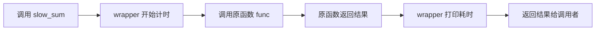

## 函数是对象

理解装饰器只需要一个前提：**Python 里函数和数字一样，是可以在变量间传递的值**。

```python filename="functions-are-objects.py"
def shout(text):
    return text.upper()

def whisper(text):
    return text.lower()

speak = shout            # 注意：没有括号！把函数本身赋给变量
print(speak("hello"))    # HELLO

for action in [shout, whisper]:
    print(action("PyThOn"))   # 依次调用两个函数
# PYTHON
# python
```

`shout` 不带括号是"函数本身"，带括号才是"调用结果"。函数还能当参数传、当返回值返回——装饰器的全部魔法都建立在这一点上。

## 闭包：记住出生环境的函数

函数在内部定义并返回时，会"随身携带"外层的变量：

```python filename="closure.py"
def make_multiplier(factor):
    def multiply(x):
        return x * factor      # multiply 记住了 factor
    return multiply            # 返回函数本身

double = make_multiplier(2)
triple = make_multiplier(3)
print(double(10))    # 20
print(triple(10))    # 30
```

`double` 和 `triple` 是同一个 `multiply` 模板生成的两个函数，但各自记住了不同的 `factor`。这种"函数 + 它记住的外层变量"就叫**闭包**（closure）。`nonlocal` 在这里能改写记住的值——上一篇的计数器正是这样工作的。

## 手写第一个装饰器

需求：给任意函数加上"打印调用耗时"。不改动原函数代码，在外面套一层：

```python filename="decorator.py"
import time

def timed(func):                     # 1. 接收原函数
    def wrapper(*args, **kwargs):    # 2. 定义替代品
        start = time.perf_counter()
        result = func(*args, **kwargs)        # 3. 调用原函数
        elapsed = time.perf_counter() - start
        print(f"{func.__name__} 耗时 {elapsed:.4f} 秒")
        return result                     # 4. 交还结果
    return wrapper

@timed
def slow_sum(n):
    return sum(range(n))

slow_sum(10_000_000)
# slow_sum 耗时 0.2341 秒
```

`@timed` 只是语法糖，等价于：

```python filename="sugar.py"
slow_sum = timed(slow_sum)   # 原函数被包进 wrapper
```

之后每次调用 `slow_sum`，实际执行的是 `wrapper`——它负责计时、转调原函数、返回结果。`*args, **kwargs` 让 wrapper 能适配任何参数签名。



<Callout type="tip" title="看懂别人代码里的装饰器">

标准库和框架里装饰器无处不在：`@staticmethod`、`@property`、Web 框架的 `@app.route("/")`、pytest 的 `@pytest.fixture`。遇到时心里翻译成"把这个函数交给 @ 后面那层加工再放回去"，就不会被吓住。

</Callout>

## functools.wraps：保住函数的身份

wrapper 顶替了原函数，`__name__` 等元信息会丢失，调试和文档工具会困惑。标准做法：

```python filename="wraps.py"
import functools

def timed(func):
    @functools.wraps(func)            # 把原函数的身份复制给 wrapper
    def wrapper(*args, **kwargs):
        ...
    return wrapper
```

写装饰器时带上 `@functools.wraps(func)`，成本一行，收益长期。

## 带参数的装饰器（读懂即可）

装饰器本身还能再包一层来接收配置：

```python filename="repeat.py"
import functools

def repeat(times):
    def decorator(func):
        @functools.wraps(func)
        def wrapper(*args, **kwargs):
            for _ in range(times):
                result = func(*args, **kwargs)
            return result
        return wrapper
    return decorator

@repeat(times=3)
def greet(name):
    print(f"你好，{name}")

greet("小明")     # 打印三行问候
```

结构是三层套娃：`repeat(times)` 返回装饰器，装饰器返回 wrapper。初学阶段**能读懂**带参装饰器即可，自己写的机会不多。

<FlashCard front="@decorator 等价于什么？" back="等价于 func = decorator(func)：把原函数传给装饰器，用返回的 wrapper 替换原名字。之后调用 func 实际执行的是包装后的函数。" />

## 动手试一试

1. 写装饰器 `logged`：每次调用前后各打印一行"进入 xxx / 离开 xxx"。
2. 写一个"结果缓存"装饰器 `cached`：用字典记住"参数 -> 结果"，参数重复时直接返回（提示：`args` 可以直接当字典键）。
3. 用闭包写 `make_greeter(greeting)`，返回的函数接收人名、输出 `"greeting, 人名"`。造两个不同问候语验证互不干扰。

<Quiz
  question="def deco(f): return f 装饰器，@deco 修饰函数 g 后，调用 g() 执行的是什么？"
  options={["被禁止", "g 原函数，只是换了个引用", "deco() 函数", "每次执行多包一层"]}
  answer={1}
  explanation="deco 原样返回 f，所以 g = deco(g) 之后 g 还是原来的函数对象。这个例子说明 @ 只是把函数送进装饰器加工，加工成什么样由装饰器决定。"
/>
