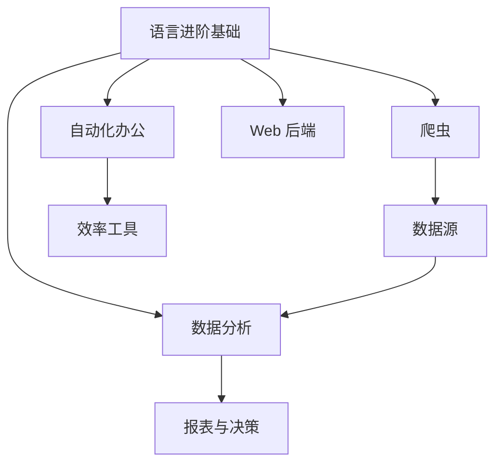

## 毕业了，然后呢

语言进阶篇（推导式、装饰器、生成器、类型注解、测试、工程化）给了你"通用武功"。接下来该选方向深入了——Python 的就业与实用场景集中在四条路上。

## 四大方向对比

| 方向 | 干什么 | 核心工具 | 上手难度 | 本站教程 |
|------|--------|----------|----------|----------|
| 爬虫与数据采集 | 自动收集网页公开数据 | requests、BeautifulSoup | 低 | [爬虫入门](/knowledge/programming/python/directions/crawler-basics/) |
| 数据分析 | 从表格数据里找答案 | pandas、matplotlib | 中 | [数据分析入门](/knowledge/programming/python/directions/data-pandas/) |
| 自动化办公 | 批量处理 Excel/PDF/邮件 | openpyxl、python-docx | 低 | [自动化办公](/knowledge/programming/python/directions/excel-automation/) |
| Web 后端 | 写网站和接口的服务端 | FastAPI、Flask | 中高 | 进阶后再开篇 |

## 怎么选

问自己两个问题：

1. **你手头有什么真实的重复劳动？** 每周要整理 Excel → 自动化办公；总想盯着某网站更新 → 爬虫。用真实需求驱动学习，动力和反馈都最强。
2. **你想要哪种职业路径？** 想做数据方向（分析师/数据工程）→ 数据分析打底；想做开发 → Web 后端；爬虫和自动化办公是最容易"立刻有用"的加分项。

<Callout type="tip" title="方向不是单选题">

四条路共享同一套底层能力（文件、HTTP、数据结构、异常处理），深入一个之后切另一个的成本很低。本站方向篇各写一篇入门，让你低成本试水再决定深耕哪条。

</Callout>

## 无论选哪条，先补齐三件事

语言进阶篇里对应的内容，选方向前务必过关：

1. **requests 与 HTTP 基础**——爬虫、调用接口都靠它（爬虫篇会讲）
2. **虚拟环境与依赖管理**——每个方向都要装第三方库（[虚拟环境](/knowledge/programming/python/advanced/venv-projects/)）
3. **异常处理与日志习惯**——真实世界的接口会超时、文件会损坏

## 学习节奏建议

- 每个方向：本站入门篇 1-2 小时 → 官方教程跟一遍 → **做一个解决自己真实问题的小项目**
- 项目比教程重要：教程给地图，项目给腿
- 卡住时先读报错、再搜报错，最后才问 AI——这个顺序能保住你的 debugging 能力

<Quiz
  question="想每周自动从网上收集公开数据并汇总成表格，最合适的学习顺序是？"
  options={["直接学 Web 后端框架", "先爬虫入门，再数据分析入门，两者组合", "只学自动化办公就够了", "先学类型注解和装饰器"]}
  answer={1}
  explanation="收集数据靠爬虫（requests），汇总成表格靠 pandas。两个方向篇正好组成这条最小路径；Web 后端和纯语言细节都不是第一步。"
/>
