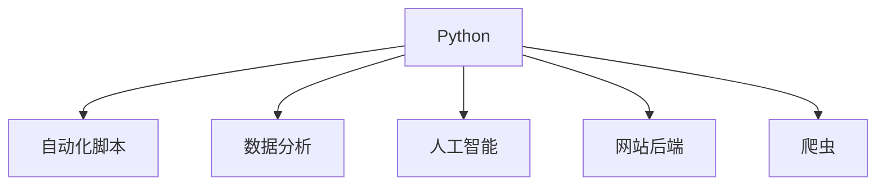

## Python 是什么

Python 是一门编程语言，也是你和计算机沟通的方式。计算机本身不会"听懂"人话，它只执行一条条明确的指令。编程就是把你想让计算机做的事情，用计算机能理解的语言写下来。

Python 诞生于 1991 年，设计目标是"让代码像英语一样好读"。同样打印一句话，其他语言可能要写好几行，Python 只需要一行：

```python filename="hello.py"
print("你好，世界")
```

## 为什么适合零基础

对初学者来说，Python 有三个明显的优点：

1. **语法接近自然语言**。没有繁琐的符号和声明，写出来的代码读起来像句子。
2. **写完马上就能运行**。不需要先理解编译、链接这些概念，保存文件、敲一个命令就能看到结果，反馈非常快。
3. **错了会说人话**。程序出错时，Python 给出的错误信息相当直白，初学者也能看懂问题出在哪一行。

<Callout type="tip" title="一个常见误解">

学编程不等于背语法。语法可以边用边查，真正要练的是"把一个问题拆成一步步指令"的思考方式。Python 的任务就是让这种练习尽量不被符号挡住。

</Callout>

## Python 能做什么

Python 的应用范围非常广，下面这些场景都有它的身影：

- **自动化脚本**：批量重命名文件、整理文件夹、定时备份，把重复劳动交给程序。
- **数据处理与分析**：用 pandas、matplotlib 处理表格数据、画图表。
- **人工智能**：机器学习和深度学习的主流语言，PyTorch、TensorFlow 都以 Python 为主接口。
- **网站后端**：Django、FastAPI 等框架支撑了大量网站服务。
- **爬虫**：按规则自动收集网页上的公开信息。



方向多意味着：先用 Python 打好基础，以后想转哪个方向都不吃亏。

<FlashCard front="Python 相比其他语言，对初学者最大的优势是什么？" back="语法接近自然语言、写完即可运行、错误信息直白，初学者可以把精力放在编程思维而不是符号细节上。" />

## 学习路线预告

本系列按四个阶段展开：

1. **入门准备**：装好环境，跑通第一个程序。
2. **基础语法**：变量、条件、循环、列表、字典、函数——所有程序的积木。
3. **进阶基础**：异常处理、文件读写、面向对象、常用标准库。
4. **实战项目**：用三个小项目把前面所学串起来。

每一篇都配有动手练习和小测验，学完即可检验。

<Quiz
  question="下面哪一项不是 Python 适合初学者的原因？"
  options={["语法接近自然语言，容易读懂", "写完马上就能运行，反馈快", "错误信息比较直白，容易定位问题", "运行速度是所有语言中最快的"]}
  answer={3}
  explanation="Python 的优势是易读、易上手和快速反馈。它的运行速度并不是最快的，但对初学者来说，开发效率远比运行速度重要。"
/>
