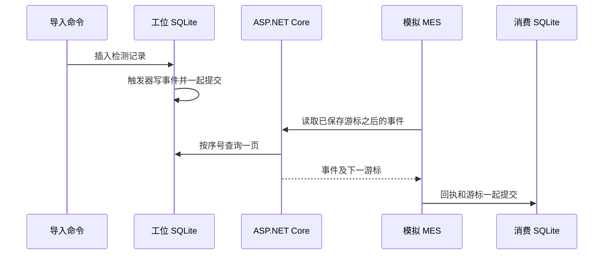

[系列路线图](/knowledge/web/full-stack/overview/) · [上一课：实时更新检测列表与本地发布](/knowledge/web/full-stack/live-inspections-and-local-publish/)

上一课的页面只需要看到当前分页。如果 MES 停机期间导入了两条记录，它恢复时需要逐条拿到这两条记录，包括已经被更新记录挤出第一页的那一条。本课给每次成功导入分配事件序号，模拟 MES 把处理进度存到自己的 SQLite 文件。

## 1. 跑通一次离线补读

使用前几课已经导入过证据的数据库。若之前指定了 `--TraceDb`，每次启动或导入都传同一路径。先停止占用 43111 的旧进程，再从仓库根目录启动本机 API。

```powershell
dotnet run --project examples/web-quality-trace/lesson-03 -- --Events:Enabled true --urls http://127.0.0.1:43111
```

打开 [事件第一页](http://127.0.0.1:43111/api/inspection-events?after=0&limit=1)，观察 `items`、`nextAfter`、`hasMore` 和 `streamId`。另开终端执行模拟 MES。用单独的文件存回执和游标。

```powershell
$consumerDb = Join-Path $env:TEMP 'atlas-mes-lesson-06.db'
node examples/web-quality-trace/lesson-03/consume-events.mjs http://127.0.0.1:43111 $consumerDb
```

首次运行会读到当前库中已有的周期，立即再运行一次时 `processed` 为 0。若之前用这个文件连接过别的教学数据库，请为这次练习选一个新的消费文件。接着停止 API，按第 03 课生成并导入一批新的工位证据，重启 API 后再次运行消费命令。它会从保存的位置接着读。

## 2. 在导入事务里写事件

启用接口时，应用在一个事务里创建事件表和 `AFTER INSERT` 触发器，并按导入时间及周期 ID 为已有检测记录补写事件。历史补写顺序由这两个字段决定。之后，只要同一个库新增检测记录，触发器就会在该插入事务里写出对应事件，独立导入进程也适用。



导入事务回滚时，触发器写入也会回滚。重复导入走已有记录分支，触发器没有新插入可处理。事件表还用唯一约束限制每个周期只出现一次。事件只保存周期引用，查询时读取只追加的检测记录。若业务以后允许编辑或删除检测记录，应把消费端需要的事件字段在写入时一并保存。 [SQLite CREATE TRIGGER](https://www.sqlite.org/lang_createtrigger.html) · [Transactional Outbox](https://learn.microsoft.com/en-us/power-platform/architecture/reference-architectures/transactional-outbox-pattern)

## 3. 用游标稳定地翻页

`after=0` 从头开始。API 查询 `Sequence > after`，按升序取最多 `limit+1` 条。多取一条用来确定 `hasMore`。返回的 `nextAfter` 是这一页最后交付的序号，空页保留原游标。客户端直接使用服务器提供的游标，序号中间即使有空缺也能继续读。

| 输入或状态 | 响应 |
| --- | --- |
| `after=0&limit=1` | 读取最早的一条事件 |
| `after=<上页 nextAfter>` | 从上页之后继续读取 |
| 当前位置已追平 | 200，`items` 为空 |
| 负数或超出 64 位范围的游标 | 400 |
| 游标超出当前事件流头部 | 409 |

游标和事件序号以十进制字符串传输，避免超过 JavaScript 安全整数范围时丢失精度。消费文件也保存源库的 `streamId`，连接到另一个事件流时会停止。备份恢复会保留原来的流标识。如果恢复旧备份后打算继续产生新事件，需要明确建立新的流身份并对账，避免沿用旧游标跳过事件。 [SQLite AUTOINCREMENT](https://www.sqlite.org/autoinc.html)

## 4. 处理成功之后再推进游标

模拟 MES 每次取得一页，把回执和 `nextAfter` 放进消费端自己的一个事务。写到一半失败，整页回滚。下次运行仍从原游标获取同一批事件。两个进程若共用一个消费文件，提交前会在事务里核对游标和流身份，发现进度已被另一个进程推进就退出，下一次从最新进度重读。

如果实际业务要调用另一个 HTTP 服务，消费端的 SQLite 事务覆盖不了那个服务。请求已经成功但游标还未保存时，下一次可能再次提交。目标端需要持久化幂等键，例如用 `streamId` 和事件序号标识同一条业务请求。

## 5. 验证重启和失败恢复

```powershell
dotnet build examples/web-quality-trace/lesson-03
node examples/web-quality-trace/lesson-03/verify.mjs --events
```

脚本使用独立的数据库，验证旧记录补写、游标分页、重复导入、停机导入、流身份不匹配，并在处理一页中的第二条事件时注入失败。你可以对照失败前后的回执数和游标，确认重跑会把两条新事件都处理完成。

继续学习 [第 07 课 · MES 已保存却没收到响应，怎样重试](/knowledge/web/full-stack/http-mes-idempotent-delivery/)。
