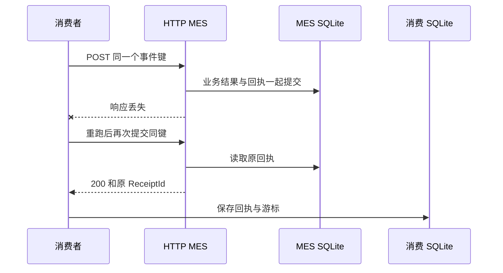

[系列路线图](/knowledge/web/full-stack/overview/) · [上一课：MES 游标补读](/knowledge/web/full-stack/durable-inspection-events/)

上一课把回执和游标保存在同一个消费库里。实际接 MES 时，中间多了一次 HTTP 调用。如果 MES 已提交结果，但响应途中断线，消费者会看到失败。本课让 MES 以稳定的事件键保存结果和回执，消费者重跑时能取回原来的受理结果。

## 1. 启动两个服务和一个消费者

先按第 06 课启动事件 API，并确保数据库里有记录。第二个终端启动本机 MES 模拟服务，使用独立的接收库。

```powershell
$mesDb = Join-Path $env:TEMP 'atlas-mes-receiver-07.db'
node examples/web-quality-trace/lesson-03/mes-receiver.mjs $mesDb
```

它监听 `http://127.0.0.1:43115/results`。第三个终端运行上一课的消费者，新增第四个参数指定 MES 地址。使用一个新的消费库，把本次 HTTP 投递进度独立保存。

```powershell
$deliveryDb = Join-Path $env:TEMP 'atlas-http-delivery-07.db'
node examples/web-quality-trace/lesson-03/consume-events.mjs http://127.0.0.1:43111 $deliveryDb http://127.0.0.1:43115
```

第一次运行会投递当前事件。再运行时 `processed` 为 0。模拟接收服务、消费者和事件 API 都使用 Node.js 24／.NET 10 的本机练习环境。接收端的数据库和消费进度分别保留。

消费文件绑定目标地址。若改端口、换接收服务，或者把第 06 课已经推进的本地模拟游标直接用于 HTTP 投递，消费者会拒绝。需要回放到另一个目标时，明确选择新的消费文件，从头读取。

## 2. 同一件事始终使用同一个键

请求使用 `streamId + ":" + sequence` 组成 `Idempotency-Key`，请求体带同样的流 ID、序号、周期 ID 和 OK／NG。重跑不会重新生成键，所以 MES 可以识别这是同一事件。

接收端在事务中按事件键查表。如果已有同键同内容，就返回原来的 `ReceiptId` 和 `AcceptedAt`。同键内容不同则返回 409。第一次受理时，业务结果和回执 ID 一起写入，提交后才返回 201。并发重复请求也由同一个 SQLite 写事务和主键约束处理。

| 状态 | MES 响应 | 消费者操作 |
| --- | --- | --- |
| 首次保存成功 | 201 和新回执 | 校验回执后继续 |
| 同键同结果 | 200 和原回执 | 视为同一业务已受理 |
| 同键不同结果 | 409 | 退出并保留进度，排查内容冲突 |
| 网络失败或响应无法读取 | 调用失败 | 退出并保留进度，下次用同键重跑 |

## 3. HTTP 与本地事务之间的空隙

消费者先给一页中的事件逐条调用 MES。所有回执校验通过后，才开启本地事务，把消费回执、MES 回执和游标一起保存。



即使 MES 都成功了，本地保存仍可能失败。此时再跑会重发这一页里的事件，MES 根据键复用原回执。你可以打开消费库中的 `HttpDeliveryReceipts`，用事件键关联到 MES 库中的 `AcceptedResults`，核对两边的回执 ID。

每个 HTTP 请求有 5 秒超时。本课的一次运行遇到失败就退出，恢复后通过再次运行命令重试。若接入定时任务，需要为网络错误和暂时性服务错误设置有上限的退避，同时保留内容冲突供人工检查。 [Azure Retry pattern](https://learn.microsoft.com/en-us/azure/architecture/patterns/retry)

## 4. 复现已经保存但响应丢失

```powershell
dotnet build examples/web-quality-trace/lesson-03
node examples/web-quality-trace/lesson-03/verify.mjs --mes
```

验证脚本给接收服务注入故障，在第一次提交完成后立即断开响应。它检查 MES 已有一条记录，但消费端游标尚未推进。随后还会验证并发重复请求复用原回执、不同内容返回 409，以及 MES 成功后本地事务回滚再重跑。最后重启接收端和事件 API，核对持久回执及消费进度。

复习时试着解释为什么超时无法证明 MES 没保存，为什么幂等记录要与受理结果一起提交，以及为什么发送端每次重试生成一个新键会失去去重效果。

继续学习 [第 08 课 · 用时间表单查询一个班次的记录](/knowledge/web/full-stack/time-range-query-and-url-state/)。
