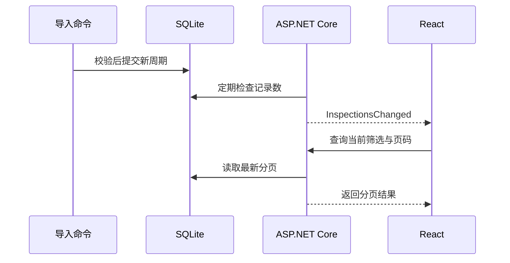

[系列路线图](/knowledge/web/full-stack/overview/) · [上一课：NG 复核](/knowledge/web/full-stack/ng-review-and-authorization/)

上一课可以查询和复核已有记录。现在保持页面打开，在另一个终端导入一条新记录，观察列表自动更新。然后关掉 API，在停机期间再导入一条，启动 API 后检查原页面能否追上数据库。

## 1. 在开发环境跑通实时更新

沿用上一课设置的三个练习密码和 SQLite 文件。在仓库根目录启动后端。如果你上次指定了 `--TraceDb`，这次也传同一路径。

```powershell
dotnet run --project examples/web-quality-trace/lesson-03 -- --Review:Enabled true --Live:Enabled true --urls http://127.0.0.1:43111
```

另开一个终端启动前端。

```powershell
cd examples/web-quality-trace/lesson-02
npm ci
npm run dev:live
```

打开 [实时检测列表](http://127.0.0.1:43112/)，保持在第 1 页。第三个终端生成一批新证据，复制输出中的一个周期目录并导入。

```powershell
dotnet run --project examples/industrial-station-evidence -- --demo
$cycle = '替换为输出中的一个周期目录'
dotnet run --project examples/web-quality-trace/lesson-03 -- --Import $cycle --Station station-a
```

列表按导入时间从新到旧排序，同一时间用周期 ID 确定顺序。若页面有过滤条件，新记录需要符合条件才能显示。再次导入相同周期时，记录总数不变。

## 2. 通知和查询各自负责什么

导入命令与 Web 服务是两个进程。前者提交 SQLite 事务后退出。后者每秒检查记录数，变化时通过 SignalR 广播 `InspectionsChanged`。教学数据只追加，因此记录数足以判断本例的导入变化。如果将来允许更新和删除，可以改用在同一事务中递增的版本或变更表。



通知只提示客户端重新查询。列表继续使用原有的分页接口和筛选参数，数据库决定哪几条该显示。这样，即使多个导入合并成一次通知，客户端也能拿到当时的最新分页。若用户正浏览旧页，偏移分页可能因新增记录而移动。回到第 1 页可以查看最新结果。

开发时，Vite 转发 `/api/live` 的 HTTP 请求和 WebSocket 升级。初次连接与重连成功后，React 都会重新查询当前页。客户端还每 15 秒补查一次，以便通知遗漏或一次查询失败后恢复。每次查询仍用上一课的取消逻辑，避免迟到响应覆盖当前结果。 [SignalR JavaScript 客户端](https://learn.microsoft.com/en-us/aspnet/core/signalr/javascript-client?view=aspnetcore-10.0)

## 3. 练习断线与补查

1. 保持浏览器在第 1 页，用 Ctrl+C 停止 API，前端继续运行。
2. 用第三个终端导入同一批证据的另一个周期。确认导入命令退出且提示成功。
3. 用相同配置重启 API。连接恢复后，页面应显示停机期间导入的周期，浏览器不需要刷新。
4. 打开 Network 面板，观察 `/api/live` 和恢复后的 `/api/inspections`。再用 NG 筛选和详情检查之前的流程。

本课恢复的是当前查询视图。若需求是逐条消费每次变化，例如给 MES 上报每一条检测，需要持久化事件编号和消费进度，并按游标补拉。

## 4. 发布到本机的单个 ASP.NET Core 服务

在仓库根目录构建前端并发布后端。发布目录只放程序文件，数据库路径使用绝对路径，以便重启仍能打开原库。

```powershell
npm --prefix examples/web-quality-trace/lesson-02 run build:live
dotnet publish examples/web-quality-trace/lesson-03 -c Release -o examples/web-quality-trace/lesson-03/.local/publish

$assets = (Resolve-Path examples/web-quality-trace/lesson-02/.local/dist).Path
$db = (Resolve-Path examples/web-quality-trace/lesson-03/.local/trace.db).Path
dotnet examples/web-quality-trace/lesson-03/.local/publish/QualityTrace.Storage.dll --Review:Enabled true --Live:Enabled true --Live:Assets $assets --TraceDb $db --urls http://127.0.0.1:43114
```

如果用自定义数据库，把 `$db` 改为实际绝对路径。打开 [本机发布版](http://127.0.0.1:43114/)，确认首页、API 和 WebSocket 使用同一个端口。此时可以停止 Vite。静态目录应仅包含前端构建产物。示例以回环 HTTP 和第 04 课的练习账号完成本机验收。

复习时试着解释三个现象：为什么导入进程不能直接给 WebSocket 发通知，为什么重连成功后还要查一次 HTTP，以及为什么同一个目录重复导入时列表不会多一行。

继续学习 [第 06 课 · 让 MES 按游标补读检测记录](/knowledge/web/full-stack/durable-inspection-events/)。
