已经会写 C#，想知道网页怎么拿到后端的数据，可以从这里开始。系列围绕一个业务流程展开：查到一条工位检测记录，查看证据，提交 NG 复核，最后看到新记录自动进入列表。前端和后端会围绕同一个检测记录接口逐步演进。

## 学习路线图

```mermaid
flowchart TD
  A["01 · 查到一条记录 / 浏览器 → ASP.NET Core API"]
  B["02 · 查一批记录 / React / TypeScript 列表、筛选与分页"]
  C["03 · 重启后仍能查 / 导入离线证据、SQLite 与集成测试"]
  D["04 · 提交 NG 复核 / 登录、授权、并发更新与审计"]
  E["05 · 新记录自动出现 / 实时更新、断线补查与部署"]
  F["06 · MES 逐条补读 / 事件游标与失败恢复"]
  G["07 · HTTP MES 投递 / 幂等键与持久回执"]
  H["08 · 班次追溯 / 时间表单、UTC 与 URL"]
  I["09 · CSV 导出 / 查询范围、编码与下载"]
  J["10 · 故障排查 / 请求编号与错误响应"]
  K["11 · 项目验收 / 真实浏览器与回归"]
  L["12 · 查询契约 / OpenAPI 与接口兼容性"]
  M["13 · 写入契约 / Cookie、CSRF 与复核冲突"]
  N["14 · 事件契约 / 游标、流身份与恢复"]
  O["15 · 数据入口校验 / TypeScript、Zod 与响应漂移"]
  P["16 · 生成查询类型 / 契约更新与编译检查"]
  Q["17 · 请求参数 / 列表与导出共用筛选"]
  R["18 · 数据恢复 / SQLite 快照与验收"]
  S["19 · 恢复对账 / 源库、游标与 MES 回执"]
  T["20 · 服务健康 / 存活、就绪与故障演练"]
  U["21 · 请求指标 / 路由、状态与耗时"]
  V["22 · SQLite 查询计划 / 筛选、排序与复合索引"]
  W["23 · 数据库升级 / 版本、事务与验证"]
  X["24 · 检测列表分页 / 深页、复合游标与写入"]
  Y["25 · 游标查询接口 / 续页、筛选与 HTTP 验收"]
  Z["26 · React 加载更多 / 追加、重试与取消"]
  AA["27 · 实时更新提示 / 首页检查与主动刷新"]
  AB["28 · 证据图缓存 / ETag 与条件请求"]
  AC["29 · 原始证据下载 / 附件与摘要校验"]
  AD["30 · 浏览器下载校验 / 重试与取消"]
  AE["31 · 双人复核冲突 / 草稿与已保存结果"]
  AF["32 · 提交响应丢失 / 查询核对与明确重试"]
  AG["33 · 登录恢复 / 草稿、权限与 CSRF"]
  AH["34 · 复核字段校验 / 错误定位与焦点"]
  AI["35 · 查询超时 / 取消与原位置重试"]
  AJ["36 · 查询限流 / 429 与等待提示"]
  AK["37 · 待复核工作台 / 状态筛选与保存联动"]
  AL["38 · 末页恢复 / 待办减少与空列表"]
  AM["39 · 多人协作 / 刷新当前复核列表"]
  AN["40 · 阶段交付 / 一键验收与失败定位"]
  AO["41 · 后端结构 / 提取检测接口模块"]
  AP["42 · 导入用例 / 作用域、事务与重复执行"]
  AQ["43 · 验收服务启动 / 探测、有限重试与故障注入"]
  AR["44 · 前端结构 / 查询 Hook 与请求生命周期"]
  AS["45 · 页面组件 / 列表、详情与回调边界"]
  AT["46 · URL 导航 / 查询串与历史恢复"]
  AU["47 · 持续集成 / GitHub Actions 自动验收"]
  AV["48 · CI 故障诊断 / 日志下载与退出码"]
  AW["49 · 每页条数 / 参数校验与浏览恢复"]
  AX["50 · 清除筛选 / URL、表单草稿与恢复"]
  AY["51 · 阶段交付 / 环境、启动与完整验收"]
  AZ["52 · 工位档案 / 创建、编辑与停用"]
  BA["53 · 用户权限 / 哈希、角色与会话撤销"]
  BB["54 · 质量统计 / UTC口径与明细核对"]
  BC["55 · 正式发布 / 数据分离与HTTPS"]
  BD["56 · 恢复验收 / 快照、升级与回退"]
  A --> B --> C --> D --> E --> F --> G --> H --> I --> J --> K --> L --> M --> N --> O --> P --> Q --> R --> S --> T --> U --> V --> W --> X --> Y --> Z --> AA --> AB --> AC --> AD --> AE --> AF --> AG --> AH --> AI --> AJ --> AK --> AL --> AM --> AN --> AO --> AP --> AQ --> AR --> AS --> AT --> AU --> AV --> AW --> AX --> AY --> AZ --> BA --> BB --> BC --> BD
```

| 课次 | 接着上一课做什么 | 完成标志 |
| --- | --- | --- |
| [01 · 从浏览器到第一个 ASP.NET Core API](/knowledge/web/full-stack/first-inspection-api/) | 建立查询接口和最小浏览器页面 | 从 Network 面板确认一次成功查询和一次 404 |
| [02 · React 检测记录列表](/knowledge/web/full-stack/react-inspection-list/) | 沿用第一课的列表和详情 URL，加入筛选、分页和详情 | 刷新后能保留筛选，旧请求不会覆盖新结果 |
| [03 · 保存与导入](/knowledge/web/full-stack/sqlite-inspection-storage/) | 用数据库替换内存数据源，导入离线工位记录并关联证据 | 重启后仍能查到记录和对应的异常图片 |
| [04 · NG 复核](/knowledge/web/full-stack/ng-review-and-authorization/) | 在详情页加入需要授权的写入操作 | 能查到谁何时提交了复核，能处理并发冲突 |
| [05 · 实时和部署](/knowledge/web/full-stack/live-inspections-and-local-publish/) | 给已有列表增加实时通知和补查 | 服务重启或浏览器断线恢复后，列表能补上遗漏记录 |
| [06 · MES 游标补读](/knowledge/web/full-stack/durable-inspection-events/) | 给入库记录加持久事件，编写模拟 MES | 消费端重启或批次回滚后能接着补读 |
| [07 · HTTP MES 投递](/knowledge/web/full-stack/http-mes-idempotent-delivery/) | 让消费者请求本机 MES | 响应丢失后重试能复用原回执 |
| [08 · 时间范围查询](/knowledge/web/full-stack/time-range-query-and-url-state/) | 在列表中选择一个班次的范围 | URL 保存 UTC 条件，刷新后能恢复当地时间显示 |
| [09 · CSV 导出](/knowledge/web/full-stack/filtered-csv-export/) | 导出当前查询结果 | 文件与筛选一致，能处理中文和字段引号 |
| [10 · 请求诊断](/knowledge/web/full-stack/request-diagnostics-and-problem-details/) | 用编号关联错误与日志 | 从页面提示找到同一次后端请求 |
| [11 · 浏览器验收](/knowledge/web/full-stack/browser-acceptance-and-course-review/) | 串联整条追溯操作 | 用独立数据库重复验证下载、复核和重启 |
| [12 · OpenAPI 查询契约](/knowledge/web/full-stack/openapi-query-contracts/) | 描述参数、模型和媒体类型 | 文档结构与真实查询响应能相互验证 |
| [13 · 登录与复核契约](/knowledge/web/full-stack/authenticated-write-contracts/) | 描述会话、令牌和写入规则 | 文档声明与实际权限检查一致 |
| [14 · 事件补读契约](/knowledge/web/full-stack/event-feed-contract-and-cursor-semantics/) | 明确游标、空页和流身份 | 契约与停机补读、失败恢复一致 |
| [15 · 响应运行时校验](/knowledge/web/full-stack/runtime-response-validation/) | 校验浏览器收到的 JSON | 字段缺失或类型漂移能显示明确错误 |
| [16 · 生成查询类型](/knowledge/web/full-stack/generated-types-and-schema-compatibility/) | 从 OpenAPI 更新类型并检查 Zod 输出 | 新增必需字段而漏同步时编译失败 |
| [17 · 类型化查询参数](/knowledge/web/full-stack/typed-query-parameters/) | 复用列表和导出的筛选与排序 | 浏览器请求和下载文件能对照验证 |
| [18 · SQLite 备份与恢复](/knowledge/web/full-stack/sqlite-backup-and-restore-drill/) | 生成一致快照并启动独立副本 | 详情、证据图、复核和事件游标能恢复 |
| [19 · 恢复后对账](/knowledge/web/full-stack/restore-delivery-reconciliation/) | 对照源库、消费库和 MES 库 | 区分正常积压、待推进和冲突 |
| [20 · 存活与就绪](/knowledge/web/full-stack/liveness-and-readiness/) | 给 API 加健康探测 | 数据库故障时就绪返回 503，恢复后回到 200 |
| [21 · 请求指标](/knowledge/web/full-stack/request-metrics-and-traffic-drill/) | 采集 HTTP 耗时并发送有限流量 | 能按路由和状态分析指标，再查单次请求日志 |
| [22 · 查询计划与复合索引](/knowledge/web/full-stack/sqlite-query-plan-and-composite-index/) | 对照列表和计数的执行计划 | 新增索引后结果一致，能解释计划差异 |
| [23 · SQLite 版本升级](/knowledge/web/full-stack/versioned-sqlite-index-migration/) | 将候选索引应用到旧库副本 | 支持安全重跑，冲突时保留原版本 |
| [24 · 检测列表的复合游标](/knowledge/web/full-stack/keyset-pagination-for-inspections/) | 用上一课的索引比较页码分页与键集分页 | 能复现插入后的重复行并解释游标边界 |
| [25 · ASP.NET Core 游标查询](/knowledge/web/full-stack/inspection-cursor-api/) | 把复合游标接到追溯台 API | 能用真实 HTTP 请求续页并验证筛选和结束状态 |
| [26 · React 加载更多](/knowledge/web/full-stack/react-load-more-inspections/) | 把游标查询接入追溯台列表 | 续页失败可重试，切换筛选后旧响应不会污染列表 |
| [27 · 浏览时提示新入库](/knowledge/web/full-stack/live-updates-during-cursor-browsing/) | 把实时通知接入游标列表 | 收到相关变化后提示更新，主动刷新前保留已加载记录 |
| [28 · 证据图的 HTTP 缓存验证](/knowledge/web/full-stack/evidence-preview-etag/) | 给详情里的 BMP 预览添加 ETag | 能复现图片未变时的 304 和图片变化后的 200 |
| [29 · 下载原始证据](/knowledge/web/full-stack/original-evidence-download/) | 让操作员下载归档 PGM 并核对摘要 | 能验证下载与工位归档一致，损坏时拒绝发送附件 |
| [30 · 详情内的下载与校验](/knowledge/web/full-stack/verified-evidence-download-ui/) | 在浏览器保存前核对 PGM 摘要 | 失败保留详情并可重试，关闭详情会取消旧下载 |
| [31 · 复核冲突与未保存草稿](/knowledge/web/full-stack/review-conflict-and-unsaved-draft/) | 将双用户提交冲突接到详情交互 | 冲突后保留草稿，重读失败可重试并核对保存结果 |
| [32 · 核对丢失响应的提交结果](/knowledge/web/full-stack/reconcile-review-after-response-loss/) | 处理已经提交但浏览器未收到回执的情况 | 查询能找到保存结果，暂未查到时保留草稿并允许重新提交 |
| [33 · 登录失效后的复核恢复](/knowledge/web/full-stack/recover-review-session-and-csrf/) | 处理会话丢失、权限变化和令牌拒绝 | 重新登录并更新令牌后，能保留说明继续提交 |
| [34 · 复核表单字段校验](/knowledge/web/full-stack/review-field-validation/) | 把输入错误定位到结论和说明 | 客户端能阻止空白提交，服务端能返回可关联到控件的字段错误 |
| [35 · 查询超时与重试](/knowledge/web/full-stack/read-timeout-and-retry/) | 给 JSON 读取设置截止时间并提供重试 | 超时能结束等待，重试保留筛选和选中周期 |
| [36 · 查询限流与等待重试](/knowledge/web/full-stack/read-rate-limit-and-retry-after/) | 给查询加入固定窗口额度并展示等待提示 | 能复现 429，按 Retry-After 等待后恢复原查询 |
| [37 · 待复核工作台](/knowledge/web/full-stack/pending-review-workbench/) | 按复核状态查询，完成处理后更新待办列表 | 列表、详情、游标和导出能对应同一处理状态 |
| [38 · 待办减少后的页码恢复](/knowledge/web/full-stack/recover-shrinking-review-pages/) | 处理末页缩小和结果为空 | 返回有效页码时保留筛选与已保存详情 |
| [39 · 多人协作下的列表刷新](/knowledge/web/full-stack/refresh-collaborative-review-list/) | 查看其他复核员处理后的最新待办 | 页码和游标模式均能保留筛选重新查询 |
| [40 · 阶段交付验收](/knowledge/web/full-stack/course-delivery-acceptance/) | 用统一入口串起接口、数据库、契约和浏览器检查 | 完整验收能重复运行，并能定位失败阶段 |
| [41 · 检测接口模块](/knowledge/web/full-stack/extract-inspection-endpoint-module/) | 把相关 HTTP 路由从启动入口提取出来 | 接口验收和契约能验证重构后的入口行为 |
| [42 · 独立证据导入用例](/knowledge/web/full-stack/extract-evidence-importer/) | 接着整理命令入口与导入规则 | 重复与冲突导入、重启查询和事件验收保持通过 |
| [43 · 可靠的测试服务启动](/knowledge/web/full-stack/reliable-test-server-startup/) | 处理验收中偶发的端口拒绝 | 有限重试可复现，业务断言失败不会被重试 |
| [44 · 提取查询 Hook](/knowledge/web/full-stack/extract-json-query-hook/) | 整理列表与详情共用的读取逻辑 | 取消、超时、重试和后台刷新通过浏览器验收 |
| [45 · 列表与详情组件](/knowledge/web/full-stack/extract-inspection-view-components/) | 将页面展示和导航职责分清 | 翻页、末页恢复和复核刷新保持连贯 |
| [46 · URL 导航与历史恢复](/knowledge/web/full-stack/extract-url-navigation-hook/) | 集中管理查询串与浏览器历史同步 | 筛选、详情和前进后退保持一致 |
| [47 · GitHub Actions 自动验收](/knowledge/web/full-stack/github-actions-acceptance/) | 将本地检查接入仓库工作流 | 内容、接口、契约和浏览器检查可由 CI 调度 |
| [48 · CI 失败日志](/knowledge/web/full-stack/ci-failure-logs/) | 保存验收输出并保留失败状态 | 失败时可上传日志，管道不会掩盖非零退出码 |
| [49 · 选择每页条数](/knowledge/web/full-stack/selectable-page-size/) | 在两种分页模式中保存列表批次大小 | 修改后重新浏览，刷新和历史恢复一致 |
| [50 · 清除筛选与表单草稿](/knowledge/web/full-stack/clear-filters-and-form-drafts/) | 清除查询条件并保留分页偏好 | URL、输入、校验错误与历史恢复一致 |
| [51 · 第一阶段交付](/knowledge/web/full-stack/stage-one-handover/) | 集中运行说明，建立后续业务阶段的基线 | 能按说明安装、启动和完整验收 |
| [52 · 工位档案管理](/knowledge/web/full-stack/station-profile-management/) | 工位创建、编辑、停用和版本冲突 | 接口、浏览器或发布演练可重复验证 |
| [53 · 持久化用户与角色](/knowledge/web/full-stack/persistent-users-and-role-revocation/) | 账号哈希、权限与旧会话撤销 | 接口、浏览器或发布演练可重复验证 |
| [54 · 质量统计与明细](/knowledge/web/full-stack/quality-statistics-and-detail-scope/) | 按工位和UTC导入范围核对统计 | 接口、浏览器或发布演练可重复验证 |
| [55 · 独立发布与HTTPS](/knowledge/web/full-stack/publish-management-and-https/) | 程序数据分离、生产配置和运行簿 | 接口、浏览器或发布演练可重复验证 |
| [56 · 备份升级与交付](/knowledge/web/full-stack/managed-backup-upgrade-and-delivery/) | 快照、未知版本拒绝与回退演练 | 接口、浏览器或发布演练可重复验证 |

每一课都交付一个能运行的检查点，后续课从上一课的结果开始。跟做时可以先跑通示例，再按教程逐步改动。复习时可以用每课末尾的问题检验自己能不能解释代码里的选择。

**开始学习** → [第 01 课：从浏览器到第一个 ASP.NET Core API](/knowledge/web/full-stack/first-inspection-api/)
