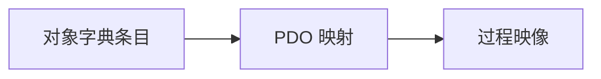

# MDX 正文组件

组件由 `src/mdx-components.tsx` 注册，文章无需 import。仍只编译人工审核的仓库 MDX。JSX 容器内部的 Markdown 前后保留空行；正文 H1 由文章页生成，目录标题放在组件外。

## Callout

```mdx
<Callout type="warning" title="先核对方向">

RxPDO 和 TxPDO 通常以设备为视角。请对照设备文档确认方向。

</Callout>
```

`type` 支持 info（默认）、tip、warning、danger；`title` 可选，缺省使用类型名称。正文支持 Markdown，不将提示声明为会打断阅读的实时 alert。服务端输出图标与文字，颜色来自统一 Token。

## Tabs / Tab

```mdx
<Tabs label="区分两个概念" defaultValue="mapping">
  <Tab value="mapping" label="PDO Mapping">

描述需要交换的条目和位长度。

  </Tab>
  <Tab value="image" label="过程映像">

主站应用读取与写入的内存视图。

  </Tab>
</Tabs>
```

Tabs 直接子项仅允许 Tab（或 React Fragment），至少一个。Tab 的 `value` 必填且同组唯一，只允许字母、数字、下划线、连字符；`label` 必须为非空文本。`defaultValue` 缺省为第一个 value，指定不存在的值会在构建时报错。`label` 为标签组的辅助阅读名称，应描述切换目的。

左右键循环切换并激活，Home/End 跳到首尾，Tab 进入当前面板；鼠标或 Enter/Space 也可激活。所有面板内容在服务端生成，客户端只管理当前项，隐藏面板不参与焦点导航。多组 Tabs 使用独立 ID，不互相影响。

Tabs 需要 JavaScript 才能切换；无 JavaScript 时仍可阅读默认面板。不要把理解主文章必需的唯一信息只放在非默认面板；正文也应有概念摘要。嵌套面板标题不会进入全局 TOC。

## Accordion

```mdx
<Accordion title="为什么数值看起来不对？" defaultOpen={false}>

核对实际过程映像的偏移、类型与长度。

</Accordion>
```

`title` 为非空文本，`defaultOpen` 缺省 false。每个折叠区独立展开，采用原生 details/summary，点击或 Enter/Space 操作；无 JavaScript 仍可使用。适用于补充说明，不应隐藏主要论证。

## CodeBlock

推荐 Markdown 围栏，不需要额外 JSX。既有 pre → CodeBlock 映射统一接管：

````mdx
```xml filename="MainWindow.xaml" {1}
<TextBlock Text="{Binding DisplayName}" />
```
````

Shiki 构建端高亮，支持文件名、行号与行强调；复制使用原始源码。围栏可放在 Tab / Accordion 内，样式与普通代码块相同。未知语言降级为纯文本，不在浏览器下载高亮引擎。

## Mermaid

推荐用 mermaid 围栏，caption 可选：

````mdx

````

也可使用 `<Mermaid chart={"flowchart LR\n A --> B"} caption="流程图" />`。图注应概括图意，重要图示关系也应在正文中解释，帮助非视觉阅读。

当前支持 flowchart / graph、sequenceDiagram、stateDiagram-v2、classDiagram、erDiagram。源码最长 10,000 字符，最多 100 条边。拒绝图内配置前言、init 指令、HTML、click 指令与外部资源地址。站点固定 strict、关闭 HTML 标签与点击绑定，再净化 SVG；主题来自 Token。限制不是任意 MDX 的执行沙箱。

图表接近可视区后才下载 Mermaid 与净化模块；隐藏 Tab 内的图表在显示后加载。主题切换重新生成；同页多图通过队列避免全局配置竞争。手机图表局部横向滚动，正文不会被撑宽。

“查看图表源码”始终保留，加载/解析失败时显示局部错误和重试，不替换整篇文章。无 JavaScript 时可展开源码。语法错误需要作者修正，重试不会自动修复源代码。

Mermaid 图形仅在客户端生成；静态搜索索引包含图注与源码，不包含动态 SVG，也不索引图表操作文字。部署仍为完整 out/，不需要服务器图表运行时、CDN 或远程字体。

## 扩展与审核

新增组件时分别定义数据契约、服务端/客户端边界、键盘语义、静态索引范围与降级内容，再加入组件映射。不要使用 eval 或把未审核 AI 字符串编译成组件。Phase 8 已注册 Quiz / FlashCard / Stepper，契约与例子见 [学习组件指南](interactive-components.md)。使用 JSX 的文章采用 `.mdx` 扩展名。

维护检查：`npm run lint`、`npm run typecheck`、`npm run test:content`、`npm run build`。浏览器另验真实文章、多个组件实例、图表失败/主题、手机局部滚动。参考 [Mermaid API](https://mermaid.js.org/config/usage) 与 [W3C Tabs 键盘约定](https://www.w3.org/WAI/ARIA/apg/patterns/tabs/)。
